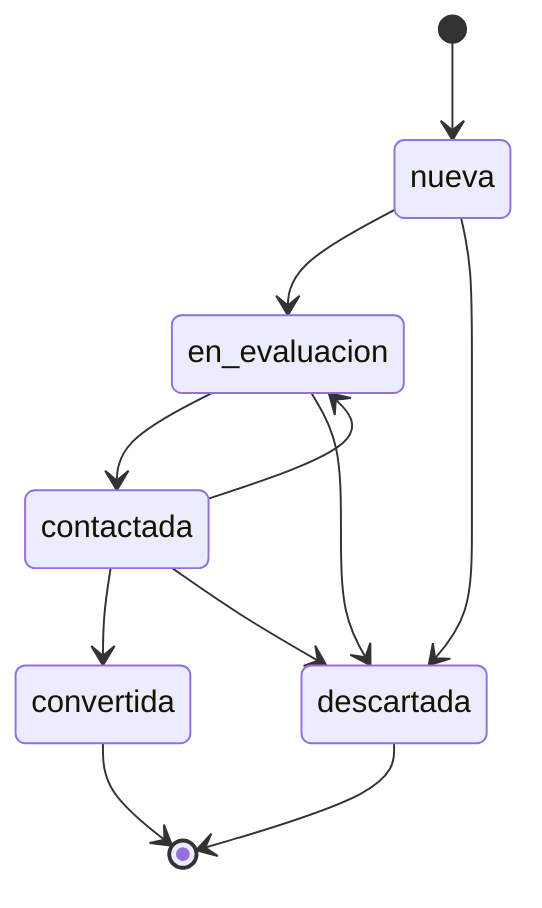
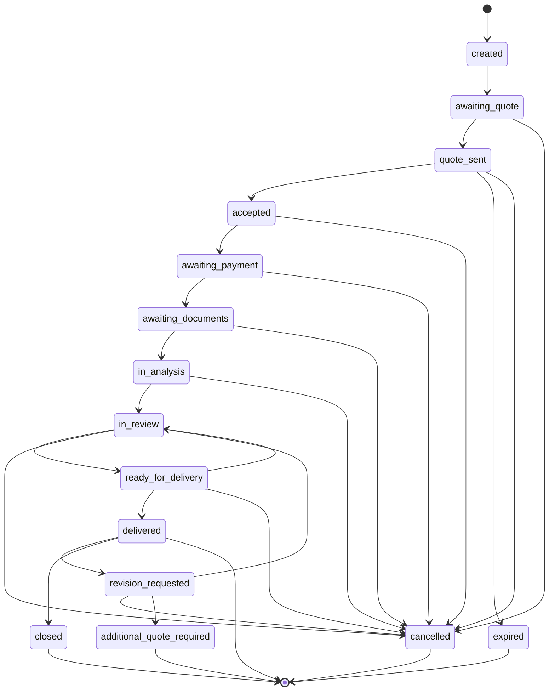
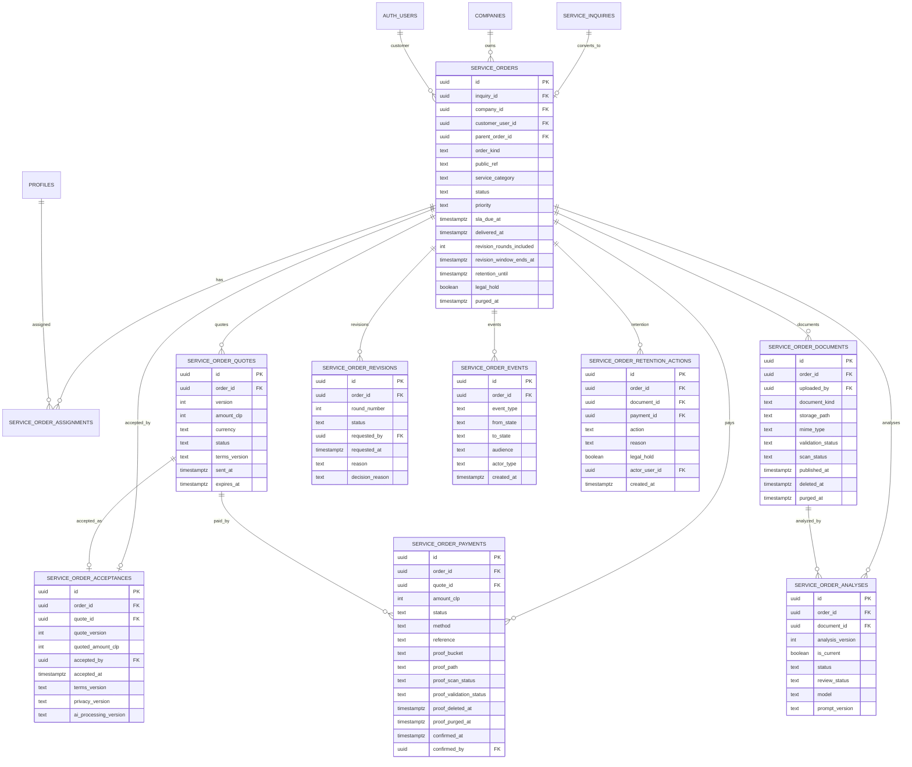

# LegalUp Services — Sprint 2 Technical Design

**Estado:** arquitectura aprobada; diseño técnico actualizado. No implementado.
**Fecha:** 2026-11-09
**Repositorio:** `/Users/juanguajardo/Desktop/upLegal/upLegal`
**Commit de referencia:** `e6882959daffd2d9226550f2963e5f71ff02c225`
**Alcance:** workflow de revisión contractual: solicitud, evaluación, propuesta, aceptación, pago confirmado, documento privado, análisis IA trazable, revisión profesional, entrega y seguimiento.

> Este documento no modifica código, no crea migraciones, no altera Supabase, Storage, variables de entorno ni despliegues. El DDL y las policies incluidas son especificación, no migraciones ejecutables.

---

## 1. Resumen ejecutivo

Sprint 2 debe convertir el intake comercial actual de `/services` en una **orden de servicio operativa y auditable**, sin mezclar la solicitud entrante con el trabajo jurídico.

La arquitectura aprobada es:

1. Mantener `service_inquiries` como **intake comercial** independiente.
2. Crear el dominio operativo `service_orders` + `service_order_quotes` + `service_order_acceptances` + `service_order_payments`, separado de `company_requests` (que pertenece al helpdesk del plan Empresa).
3. Crear el bucket privado `service-documents`, solo para PDF contractual, y prohibir el uso de `documents` para contratos de Services.
4. Crear el bucket privado separado `service-payment-proofs`, solo para comprobantes PDF/PNG/JPEG; no se mezclan con documentos contractuales.
5. Soportar solo PDF en documentos contractuales; DOCX queda fuera de alcance.
6. Exigir **aceptación explícita versionada** de la propuesta, términos y tratamiento de datos, más **confirmación de pago registrada administrativamente**, antes de iniciar el trabajo operativo.
7. Incluir **una ronda de cambios** en `service_order_revisions`; cambios adicionales requieren evaluación y nueva cotización.
8. Reutilizar el motor IA existente (`extractPdfText`, esquema de análisis, validación de evidencia, metering), condicionado a verificar contractualmente tratamiento de datos, no entrenamiento y retención del proveedor.
9. Incorporar **escaneo de malware** antes del procesamiento automático en ambos buckets. Mientras no exista un mecanismo confiable, los archivos permanecen en cuarentena y no se procesan.
10. Incorporar una **bandeja administrativa mínima** para solicitudes, órdenes, propuestas, pagos, comprobantes y asignaciones.
11. Usar **notificaciones por correo** en v1; no implementar mensajería interna.
12. Hacer que toda mutación sensible ocurra server-side con `service_role`; el cliente solo lee el informe final aprobado.
13. Mantener la IA como asistencia preliminar: ningún resultado se entrega sin revisión profesional y aprobación humana.
14. Incorporar retención, legal hold y purga auditables sin fijar plazos legales en este documento.
15. No migrar documentos históricos del bucket público en este sprint.

El principal riesgo actual es que el bucket `documents` es **público** y varias pantallas de Empresa usan `getPublicUrl` para documentos de clientes. Ese bucket no puede sostener el Sprint 2. No se modifica su estructura ni sus policies en este sprint; su remediación es un trabajo de seguridad independiente.

---

## 2. Objetivos y no objetivos

### 2.1 Objetivos

- Recibir una solicitud desde la landing sin prometer precio ni plazo automático.
- Calificar la solicitud y convertirla en orden solo por acción humana.
- Versionar propuesta económica y condiciones, con expiración explícita.
- Obtener aceptación explícita del owner/admin autorizado de la empresa y persistirla de forma inmutable.
- Registrar administrativamente la confirmación de pago con comprobante separado antes de iniciar el trabajo operativo.
- Almacenar documentos contractuales en un bucket privado y comprobantes en otro bucket privado.
- Someter cada archivo a escaneo de malware antes del procesamiento automático; sin escáner confiable, mantener cuarentena.
- Analizar el documento contractual con IA y vincular cada hallazgo a evidencia documental.
- Permitir revisión, corrección y aprobación por un profesional asignado, con versionado de análisis.
- Entregar solo el informe final aprobado y mantener trazabilidad de estados, eventos y accesos.
- Incluir una ronda de cambios en el alcance inicial, con ventana y auditoría.
- Operar con notificaciones por correo y una bandeja administrativa mínima.
- Aplicar retención, legal hold y purga auditables.
- Medir costo, SLA, calidad y conversión sin inventar precios.

### 2.2 No objetivos de Sprint 2

- No implementar pasarela de pago nueva; la confirmación de pago se registra administrativamente en v1.
- No aceptar DOCX ni otros formatos en documentos contractuales; el comprobante sí admite PDF/PNG/JPEG, pero en su propio bucket.
- No definir una lista de precios.
- No reemplazar el helpdesk de `company_requests`.
- No construir un marketplace de abogados.
- No prometer análisis de documentos escaneados sin texto: el pipeline actual no hace OCR.
- No soportar DOCX en la primera entrega: el parser verificado es PDF.
- No implementar mensajería interna en v1; solo correo.
- No migrar documentos históricos del bucket público en este sprint.
- No modificar el bucket `documents` ni sus policies existentes.
- No convertir la IA en firma, dictamen ni asesoría legal autónoma.
- No procesar documentos reales hasta que exista política de retención aprobada, escáner de malware confiable y pruebas de autorización aprobadas.

---

## 3. Restricciones y método

- Solo se permite auditoría de repositorio y de Supabase en modo lectura, más este documento.
- La fuente de verdad del esquema desplegado es Supabase live, porque varias migraciones antiguas del repositorio están vacías o no contienen la creación original de tablas de Empresa.
- Toda referencia a comportamiento actual se marca como **verificada** cuando tiene archivo/línea o consulta live.
- Lo propuesto se marca como **propuesto** y no debe presentarse como existente.
- No se fijan precios, plazos comerciales ni retención legal en este documento; se exponen como variables que requieren decisión.
- La retención documental debe quedar definida en una política aprobada antes de procesar documentos reales en producción.
- Las condiciones del proveedor IA deben verificarse documentalmente; este documento no afirma ZDR ni no-entrenamiento mientras no exista respaldo contractual.

---

## 4. Estado actual verificado

### 4.1 Infraestructura de datos

Proyecto Supabase `lgxsfmvyjctxehwslvyw` (`upLegal`), organización `hnwjnsrdrvhyslhtazti`, región `us-west-1`, Postgres `17.4.1.054`, estado `ACTIVE_HEALTHY`.

**Verificado live:** las tablas relevantes tienen RLS habilitado:

| Tabla | RLS | Situación relevante |
|---|---:|---|
| `service_inquiries` | Sí | Intake comercial; solo admin/service_role. |
| `company_requests` | Sí | Helpdesk Empresa; estados y SLA propios. |
| `company_request_documents` | Sí | RLS habilitado pero **sin policies visibles**; acceso efectivo server-side. |
| `company_documents` | Sí | Policies owner; no sustituye un ACL documental de orden. |
| `request_messages` | Sí | Gap: el abogado asignado no puede leer mensajes que no envió. |
| `company_activity_log` | Sí | Auditoría de Empresa, no de Services. |
| `ai_documents` | Sí | Documento IA propiedad del abogado; writes server-side. |
| `ai_document_analyses` | Sí | Cliente solo SELECT; writes server-side. |
| `ai_workspaces` | Sí | Caso IA del abogado. |
| `notifications` | Sí | Notificaciones existentes. |

### 4.2 `service_inquiries` — intake existente

Definida en `supabase/migrations/20261108231852_service_inquiries.sql:8`.

- Campos: `contact_name`, `company_name`, `email`, `phone`, `service_category`, `description`, `status`, `origin`, `privacy_accepted_at`, `idempotency_key`, timestamps.
- Categorías: `contratos`, `cobranza`, `documentacion-laboral` (`:33`).
- Estados: `nueva`, `en_evaluacion`, `contactada`, `convertida`, `descartada` (`:37-38`).
- Origen forzado: `services_landing` (`:39`).
- RLS habilitado (`:66`); se revocan permisos a `anon`/`authenticated` y solo se concede SELECT a `authenticated` (`:69-71`); policy de lectura solo admin (`:73-75`).
- No tiene documentos, propuesta, orden, profesional asignado ni aceptación contractual.
- `privacy_accepted_at` tiene `DEFAULT now()` (`:18`), por lo que por sí solo **no prueba** que el usuario haya visto y aceptado una versión concreta de la política.

**Conclusión:** sirve como intake, no como orden.

### 4.3 `company_requests` — no se reutiliza

Verificado live y en migraciones:

- FKs a `companies`, `auth.users` (`user_id`, `lawyer_id`, `assigned_by`).
- Estados: `nueva`, `asignada`, `en_revision`, `esperando_documentos`, `esperando_cliente`, `presupuesto_enviado`, `presupuesto_aprobado`, `en_ejecucion`, `finalizada`, `cancelada`, `sla_breached`.
- SLA, `first_response_at`, `assigned_at`, `closed_at`, `is_out_of_plan`.
- RLS de Empresa: `security_company_access(company_id, true)` o `lawyer_id = auth.uid()` (`supabase/migrations/20260913000000_company_authorization_authorities.sql:132-151`).
- El trigger protege `company_id`, `user_id`, `lawyer_id`, `assigned_by` (`:94-106`), pero **no impide que un miembro de empresa cambie `status`** por update directo.
- `company_request_documents` no tiene policies de cliente; la API de Empresa usa service role.
- `request_messages_select` solo considera empresa o `sender_id = auth.uid()`; un profesional asignado no puede leer mensajes de la empresa que no envió (policy live).

**Conclusión:** `company_requests` modela soporte por plan, no una contratación de servicio con propuesta, aceptación y entrega. Reutilizarla mezclaría dominios y heredaría gaps de autorización. Se decide **no reutilizarla** para Sprint 2.

### 4.4 Almacenamiento

Buckets live verificados:

| Bucket | Público | Límite | MIME | Uso actual |
|---|---:|---:|---|---|
| `documents` | **Sí** | 5 MB | PDF/JPEG/PNG/JPG | Documentos de Empresa y PDFs generados. |
| `ai-documents` | No | 20 MB | `application/pdf` | Documentos de LegalUp AI. |
| `avatars` | Sí | Sin límite | — | Avatares. |

Riesgo crítico:

- `documents` es público y se usa con `getPublicUrl` en `src/pages/empresa/NewRequest.tsx:72` y `src/pages/empresa/LegalCenter.tsx:277`.
- También se usa para PDFs generados en `server/documents.mjs:298` y `src/documents/engine/generateDocument.ts:100`.
- `src/lib/storage.ts:15-17` incluye `documents` como bucket permitido y `getPublicUrl` en `:81-89`.
- La subida en `NewRequest.tsx:62-72` y `LegalCenter.tsx:270-277` no valida MIME real, solo el tipo declarado por el navegador.

**Conclusión:** ningún documento contractual de Sprint 2 puede ir a `documents`. Se requiere bucket privado nuevo.

`ai-documents` es privado y tiene límite real de 20 MB/PDF (`supabase/migrations/20260803000200_ai_documents_bucket_size_limit.sql:2-17`). Su acceso está diseñado para el dominio LegalUp AI: policies de `ai_documents` amarradas a `lawyer_id`, `workspace_id` y `file_path` (`supabase/migrations/20260923000000_ai_core_authorities.sql:38-48`), con URL firmada de 1 hora (`src/hooks/useAIDocuments.ts:370-371`; servidor `server.mjs:10885-10900`).

**Conclusión:** reutilizar `ai-documents` acoplaría el servicio al workspace IA del abogado y a sus cuotas. Se decide crear un bucket `service-documents` independiente.

### 4.5 Motor IA existente

Verificado:

- Esquema `AIDocumentAnalysisSchema` en `server.mjs:703-716`: `summary`, `document_type`, `parties`, `key_points`, `obligations`, `deadlines`, `risks`, `recommendations`.
- Normalización de plazos con `normalizeDeadlineItem` (`server.mjs:82`, `:717`).
- Prompt de sistema y usuario en `server/ai/legalPrompt.mjs:5` y `:90-95`.
- El prompt de usuario interpola `filename` y `extractedText` directamente (`:90-95`).
- Validación Zod del resultado en `server.mjs:10712`.
- Construcción de claims y evidencia con `source_id`, `fragment_id`, `evidence` y `honestEvidenceLocation` en `server.mjs:10721-10731`; persistencia en `evidence_sources` en `:10775`.
- Validación de `fragment_id`/evidencia contra el documento en `server.mjs:11509-11560`.
- Extracción PDF con `pdfjs-dist`: magic bytes `%PDF-`, `isEvalSupported: false`, máximo 200 páginas (`server/ai/pdfText.mjs:17`, `:57-95`).
- Límite de texto extraído: `MAX_EXTRACTED_TEXT_CHARS = 80000` (`server.mjs:566`); truncado en `:10539`.
- El prompt no contiene una instrucción explícita contra prompt injection en el contenido del documento. Sí delimita el documento (`legalPrompt.mjs:93-95`), pero no ordena tratarlo como datos no confiables.
- El proveedor es OpenAI-compatible; `AI_PROVIDER_BASE_URL` por defecto es `https://api.openai.com/v1` y el modelo por defecto `gpt-4o-mini` (`server/ai/provider.mjs`). OpenRouter con ZDR es una opción configurable, no el estado por defecto. La configuración efectiva de producción no se verificó en este sprint.
- Costos: `providerUsage` y `estimateAICostUsd` existen en `server/ai/modelCosts.mjs`; el consumo se acumula en `ai_usage_monthly` vía RPC (`supabase/migrations/20260804000000_ai_usage_cost_tracking.sql:61-90`).

**Conclusión:** el motor es reutilizable, pero el dominio Services necesita persistencia y control de acceso propios, y refuerzos de prompt injection y confidencialidad.

### 4.6 UI y endpoints existentes

- Landing `/services`: `src/pages/LegalUpServices.tsx`, formulario `src/components/services/ServicesRequestForm.tsx`, catálogo `src/data/servicesCatalog.ts`.
- Envío: `src/lib/servicesInquirySchema.ts`, `src/services/servicesInquiryService.ts`, handler `server/services/inquiries.mjs` con rate limit e idempotencia.
- Empresa: `src/pages/empresa/NewRequest.tsx`, `LegalCenter.tsx`, `RequestsList.tsx`, `RequestDetail.tsx`, `Documents.tsx`, `Budgets.tsx`.
- Endpoints Empresa: `POST /api/empresas/requests` (`server.mjs:5725`), `POST /api/empresas/requests/:requestId/documents` (`:5878`), SLA (`:7476`), timeline (`:7651`), conversación (`:7702`, `:7795`), presupuestos (`:7886-7932`).
- No se encontró un panel administrativo de `service_inquiries` en el repositorio auditado.

### 4.7 Matriz de capacidad

| Capacidad | Estado | Evidencia | Decisión Sprint 2 |
|---|---|---|---|
| Intake comercial | Verificado | `service_inquiries` + handler | Reutilizar. |
| Rate limit/idempotencia intake | Verificado | `server/services/inquiries.mjs` | Reutilizar patrón. |
| Orden operativa de servicio | Inexistente | — | Crear `service_orders`. |
| Propuesta versionada | Inexistente | — | Crear `service_order_quotes`. |
| Aceptación explícita | Inexistente | — | `service_order_acceptances` inmutable; solo owner/admin. |
| Confirmación de pago | Inexistente | — | `service_order_payments` + comprobante separado; solo admin confirma/rechaza; sin pasarela. |
| Documento privado | Parcial | `ai-documents` privado, pero acoplado a IA | Crear `service-documents` (PDF contractual) y `service-payment-proofs`. |
| Validación MIME real | Parcial | Parser PDF valida `%PDF-`; upload cliente no | Finalize server-side; magic bytes por formato. |
| Escaneo de malware | Inexistente | No hay escáner verificado en el repositorio | Integrar escáner; si no existe, cuarentena y no procesar. |
| Análisis IA | Verificado | `server.mjs:10703-10775` | Reutilizar motor, condicionado a validación contractual. |
| Evidencia por hallazgo | Parcial | claims/evidence y validación | Reutilizar y exigir en revisión. |
| Revisión profesional | No verificada como flujo Services | UI IA existe, no orden de servicio | Crear flujo de revisión; cliente no ve crudo. |
| Entrega | Inexistente | — | Solo informe final aprobado. |
| Ronda de cambios incluida | Inexistente | — | `service_order_revisions`; una ronda y ventana aprobada; adicionales requieren nueva cotización. |
| Retención/legal hold | Inexistente | — | Campos de retención + `service_order_retention_actions`; sin plazos inventados. |
| Auditoría de orden | Inexistente | `company_activity_log` es de Empresa | Crear `service_order_events` append-only. |
| Mensajería interna | Inexistente y fuera de alcance | `request_messages` tiene gap | No implementar; usar correo. |
| Notificaciones por correo | Verificado | `server/notifications/service.mjs` | Reutilizar con `eventId`. |
| Panel admin mínimo | No verificado | — | Implementar bandeja administrativa mínima. |

---

## 5. Decisiones de arquitectura

### D1 — Separar intake de orden

`service_inquiries` registra interés. La orden nace solo cuando un operador califica y convierte. Esto evita que un formulario público cree trabajo jurídico, documentos o compromisos.

### D2 — Tabla operativa nueva: `service_orders`

No se reutiliza `company_requests` porque:

- Su semántica es soporte por plan, con `company_subscriptions`, `is_out_of_plan` y SLA de plan.
- Sus estados no incluyen propuesta, aceptación, análisis IA, revisión ni entrega.
- Su RLS permite updates de empresa sobre campos de estado.
- Su mensajería tiene un gap de lectura para el profesional asignado.
- Sus documentos viven en un bucket público.

### D3 — Bucket privado nuevo: `service-documents`

- `public = false`.
- Límite: 20 MB (alineado con el límite IA verificado); puede ser menor si negocio lo decide.
- MIME permitido: `application/pdf`.
- Solo almacena documentos contractuales: insumos, anexos y entregables. No almacena comprobantes de pago.
- Sin policies de cliente. Acceso solo por URL firmada emitida por servidor tras autorización.
- Ruta generada server-side: `quarantine/{company_id}/{order_id}/documents/{document_id}/{uuid}.pdf` hasta el escaneo; luego `clean/{company_id}/{order_id}/documents/{document_id}/{uuid}.pdf`.
- Sin `getPublicUrl` en ningún punto del flujo.

### D4 — Profesional asignado como ACL

El acceso del profesional no depende de `profiles.role` ni de pertenecer a la empresa. Depende de una asignación activa en `service_order_assignments`. El rol profesional se valida además en servidor al asignar.

`service_order_assignments` es la **única fuente de verdad** de la asignación. `service_orders` no duplica `assigned_professional_id`, `assigned_at` ni `assigned_by`. Una reasignación revoca la asignación anterior y crea una nueva dentro de la misma transacción; el historial se conserva.

### D5 — IA reutilizada, persistencia propia y proveedor condicionado

Se reutilizan extracción, prompt, esquema, evidencia y metering. No se reutilizan `ai_documents` ni `ai_document_analyses` como almacenamiento principal del servicio, porque están acoplados a `lawyer_id`/`workspace_id` y a cuotas de LegalUp AI.

La reutilización queda condicionada a verificar documentalmente: contrato del proveedor, tratamiento de datos, no entrenamiento con datos del cliente, retención, subprocesadores y transferencia internacional. No se afirmará ZDR ni no-entrenamiento sin respaldo contractual.

### D6 — Primera entrega solo PDF

El parser verificado es PDF. Aceptar DOCX exigiría conversión y una superficie de ataque nueva. Los PDFs escaneados sin texto se rechazan con instrucción de subir una versión con texto seleccionable; no se promete OCR ni se inventa contenido.

### D7 — Escritura server-side

El cliente no inserta ni actualiza órdenes, cotizaciones, asignaciones, documentos, análisis ni eventos. El servidor autoriza y usa `service_role`. RLS funciona como segunda barrera para lectura y como denegación por defecto.

### D8 — Aceptación versionada e inmutable

La aceptación se persiste en `service_order_acceptances`, no en campos dispersos de la orden ni de la cotización. Registra la versión y el monto de la cotización aceptada, las versiones de términos, privacidad y tratamiento IA, los checkboxes explícitos, el actor y el hash del texto de aceptación.

Una cotización enviada no se edita: se supersede con una nueva versión. La aceptación es un registro inmutable, único por orden, y solo la puede realizar un owner/admin autorizado de la empresa dentro de la vigencia de la cotización.

### D9 — La IA no entrega

El análisis IA es insumo interno. El cliente recibe únicamente el informe final generado desde el resultado **revisado y aprobado** por el profesional. El cliente no tiene acceso al `result_json`, a hallazgos pendientes ni a borradores. La IA no envía correos, no cambia estados y no publica entregables.

### D10 — Pago confirmado antes de operar, con comprobante separado

La aceptación comercial no inicia el trabajo. La orden pasa por `awaiting_payment`. El owner/admin de la empresa sube el comprobante a un flujo y bucket separados; un admin lo revisa y solo entonces **confirma o rechaza** el pago con motivo y auditoría. Un fallo automático de validación/escaneo rechaza el intento sin confirmar. La orden llega a `awaiting_documents` únicamente cuando existe un pago `confirmed` asociado a la cotización aceptada.

En v1 no se implementa pasarela: `service_order_payments` guarda monto, método, referencia, intento, comprobante, actor y timestamps. Un rechazo deja la orden en `awaiting_payment` y permite un nuevo intento; el intento rechazado no se edita. El cliente nunca puede autodeclarar un pago como confirmado y un profesional no accede a pagos ni comprobantes.

### D11 — Cuarentena y escaneo de malware (`MalwareScannerPort`)

Todo archivo cargado, contractual o comprobante de pago, entra en cuarentena lógica en almacenamiento privado (`quarantine/{company_id}/{order_id}/...`). El procesamiento automático de documentos contractuales solo se habilita con `scan_status = 'clean'` y `validation_status = 'validated'`. Si no existe un escáner confiable o el análisis falla, el objeto permanece en cuarentena y no se procesa; en documentos el estado queda `quarantined`, y en comprobantes el intento se marca `rejected` sin promover el objeto a `clean`.

Para garantizar que el desarrollo y las pruebas automatizadas no queden bloqueados mientras se formaliza el proveedor comercial definitivo, la arquitectura desacopla el escaneo mediante una interfaz explícita y valida en tiempo de arranque el adaptador correspondiente:

1. **Interfaz del puerto (`MalwareScannerPort`):**
   ```typescript
   export type MalwareScanStatus = 'clean' | 'infected' | 'failed' | 'unavailable';

   export interface MalwareScanResult {
     status: MalwareScanStatus;
     provider: string;
     details?: string;
     durationMs?: number;
   }

   export interface MalwareScannerPort {
     readonly name: string;
     scanBuffer(params: {
       buffer: Buffer;
       filename: string;
       mimeType: string;
     }): Promise<MalwareScanResult>;
   }
   ```

2. **Adaptador para development (`MockMalwareScanner`):**
   - Exclusivo para el entorno `development` (`NODE_ENV === 'development'` o ejecución de tests unitarios locales).
   - En `development` se utilizan exclusivamente archivos y buffers sintéticos; el procesamiento comercial de documentos reales está estrictamente deshabilitado.
   - Prohibido y rechazado terminantemente en `production`: si el servidor arranca en `production` (`NODE_ENV === 'production'`) con el adaptador mock seleccionado, el proceso falla de forma cerrada al iniciar (*fail-closed startup assertion*).
   - Utiliza únicamente archivos y buffers sintéticos: detecta la cadena de prueba estándar EICAR (`X5O!P%@AP[4\PZX54(P^)7CC)7}$EICAR-STANDARD-ANTIVIRUS-TEST-FILE!$H+H*`) para simular `status = 'infected'`, cadenas testigo de fallo para simular `failed` o `unavailable`, y aprueba como `clean` los documentos sintéticos válidos de prueba.

3. **Adaptador de producción desacoplado (Vendor-Agnostic):**
   - En `production`, se exige obligatoriamente un scanner antimalware real operativo configurado. Si no existe un scanner real configurado o falla su verificación de disponibilidad al arrancar, el servidor bloquea el inicio del proceso en producción.
   - El adaptador definitivo implementa `MalwareScannerPort` interactuando con el motor de seguridad que defina LegalUp, sin que las rutas ni la máquina de estados conozcan la implementación específica.
   - **Timeout estricto:** El escaneo no puede superar los 8 segundos por archivo. Si el servicio externo no responde en ese plazo, se aborta la petición y se clasifica como `unavailable` (fail-closed; el archivo queda en cuarentena).
   - **Manejo de archivos infectados:** Un archivo con `status = 'infected'` se elimina inmediatamente del Storage de Supabase, se marca `scan_status = 'infected'` y `validation_status = 'rejected'` con `deleted_at = now()`, y se emite un evento de seguridad sanitizado que no expone la firma del exploit ni rutas internas en logs públicos.
   - **Indisponibilidad y reintentos:** Archivos en `quarantined` por `unavailable` o `failed` pueden ser reanalizados mediante la acción administrativa `POST /api/services/admin/orders/:id/quarantine/:docId/retry`.
   - **Evaluación de riesgo de confidencialidad en multiscanners externos:** Los servicios de escaneo multimodelo públicos comunitarios (como el nivel gratuito o público de VirusTotal) distribuyen las muestras de archivos analizados a firmas de ciberseguridad socias a nivel global. Enviar contratos comerciales, acuerdos de confidencialidad (NDAs) o balances corporativos a servicios que redistribuyen muestras constituye una violación directa del secreto comercial y deber de custodia. El adaptador de producción debe operar exclusivamente con un motor privado dedicado (ej. contenedor ClamAV en VPC privada o API corporativa cerrada con garantía explícita de no compartición ni retención de muestras).

4. **Tratamiento de comprobantes:** Los comprobantes de pago se escanean y validan por magic bytes (`PDF`, `PNG`, `JPEG`), pero nunca se envían al parser contractual ni a la IA.

### D12 — Bandeja administrativa mínima

v1 incluye una bandeja admin para gestionar inquiries, órdenes, cotizaciones, pagos y comprobantes, confirmaciones/rechazos, asignaciones, cuarentena y revisiones. La operación no debe depender de SQL manual. La bandeja no reemplaza el panel de Empresa ni el workspace IA.

### D13 — Una ronda de cambios

La cotización inicial incluye una ronda de cambios sobre el informe entregado. La ventana para solicitarla se fija al entregar desde una política comercial aprobada; no se hardcodea en este documento. La solicitud y su resultado se persisten en `service_order_revisions`; no se usan contadores duplicados en la orden.

La segunda solicitud de cambios no se ejecuta automáticamente: se registra como rechazada por ronda agotada y genera evaluación y una nueva cotización. Para mantener trazabilidad, se crea una orden vinculada `additional_changes` con `parent_order_id`; esa nueva orden vuelve a exigir aceptación y confirmación de pago.

### D14 — Correo únicamente

v1 notifica por correo usando el servicio existente. No se implementa mensajería interna ni tabla de mensajes. El correo no incluye documentos adjuntos ni enlaces públicos; usa enlaces de sesión autenticada.

### D15 — Remediación histórica separada

Los documentos históricos del bucket público `documents` no se migran en Sprint 2. Se documenta un trabajo de seguridad independiente para inventario, rotación de acceso, migración a bucket privado y comunicación, sin modificar el bucket ni sus policies en este sprint.

### D16 — Comprobante de pago en bucket y formato propios

El comprobante de pago no es un documento contractual y no se almacena en `service-documents`. Se usa un bucket privado separado, `service-payment-proofs`:

- `public = false`; sin policies de cliente; acceso solo por URL firmada de 300 segundos emitida por servidor.
- Límite: 20 MB.
- MIME permitido: `application/pdf`, `image/png`, `image/jpeg`; se valida por magic bytes, no solo por `Content-Type`.
- Rutas server-side: `quarantine/{company_id}/{order_id}/payments/{payment_id}/{uuid}.{ext}` y luego `clean/{company_id}/{order_id}/payments/{payment_id}/{uuid}.{ext}`.
- Solo owner/admin de la empresa puede subir y ver el comprobante de su orden; solo admin puede confirmar o rechazar el pago. Profesional, member y viewer no acceden.
- El comprobante no se analiza con IA, no se publica y no se reutiliza como documento contractual.

### D17 — Gate de producción para documentos reales (`CommercialReadinessGate`)

LegalUp opera exclusivamente con dos entornos: **`development` (dev)** y **`production`**. No existe entorno de staging, preproducción ni entornos intermedios adicionales.

Se establece una distinción estricta entre el despliegue técnico del código y la habilitación comercial del procesamiento de documentos reales:

- **En `development`:** El procesamiento comercial de documentos reales está **deshabilitado por diseño**. Solo se permite la ejecución de pruebas con archivos y buffers sintéticos utilizando `MockMalwareScanner`.
- **En `production`:** El procesamiento comercial de documentos reales permanece **bloqueado a nivel de aplicación** hasta que se satisfagan, comprueben y registren copulativamente dos categorías independientes de verificación:

#### Categoría A: Verificaciones Técnicas (Startup + Runtime)
1. **Scanner antimalware real configurado y operativo:**
   - Integración activa con un motor de producción certificado bajo `MalwareScannerPort`.
   - `MockMalwareScanner` es terminantemente rechazado en producción.
   - Ejecución de un healthcheck activo contra el scanner en tiempo de arranque.
   - **Monitoreo continuo de disponibilidad en runtime:** Si el servicio de escaneo deja de responder o degrada durante la operación, el gate bloquea dinámicamente nuevas cargas (*circuit breaker* a fail-closed).
2. **Concordancia técnica de parámetros de retención:**
   - Carga y validación en arranque de los parámetros de retención (valores numéricos de retención para órdenes entregadas, canceladas y comprobantes de pago dentro de rangos lógicos).
   - **Verificación de concordancia estricta:** Los parámetros técnicos desplegados y configurados en producción deben corresponder exactamente a la versión y valores formalmente aprobados en la Categoría B. Cualquier discrepancia o modificación no aprobada bloquea de inmediato el gate (*discrepancy lock*).
3. **Worker de purga desplegado y con evidencia operativa vigente:**
   - El worker/cron de purga debe estar registrado y habilitado en la infraestructura de producción.
   - **Verificación de evidencia operativa:** El gate comprueba que conste un registro auditable de ejecución satisfactoria reciente:
     - Fecha y hora de la última ejecución satisfactoria (`last_successful_run_at`).
     - Resultado registrado (`last_run_result = 'success'`).
     - Antigüedad de la última ejecución inferior a la ventana máxima permitida (`max_purge_staleness_window_hours`), la cual debe ser un parámetro formalmente aprobado por la administración de LegalUp y no un valor inventado o asumido.
     - Ausencia de estados de error o ejecuciones fallidas críticas no resueltas.
   - Si la evidencia operativa está ausente (el worker nunca ha ejecutado con éxito), vencida respecto a la ventana máxima permitida o presenta fallos no resueltos, el procesamiento comercial se bloquea automáticamente.
   - **Prueba no destructiva en el arranque:** La verificación de arranque valida la conectividad, permisos de Storage (`service-documents` y `service-payment-proofs`) y la ruta de base de datos mediante un chequeo de sólo lectura o dry-run sin órdenes elegibles. **Bajo ninguna circunstancia se ejecuta una purga destructiva de datos reales como prueba durante el inicio.**

#### Categoría B: Aprobaciones Documentales y Externas (Registro Formal de Compliance)
4. **Aprobación formal y versionada de la política de retención:**
   - La política de retención no se considera aprobada únicamente porque existan parámetros numéricos válidos en variables o configuración.
   - Debe existir evidencia administrativa auditable formalmente registrada en base de datos que identifique:
     - `policy_version`: versión formal de la política.
     - `approved_at`: fecha y hora de aprobación.
     - `approved_by`: responsable / cargo que la aprobó.
     - `authorized_parameters`: parámetros numéricos exactos autorizados para cada tipo de documento y estado.
     - `status`: vigencia o estado de aprobación activo (`approved` / `active`).
   - Un cambio de parámetros sin una nueva aprobación formal registrada mantiene bloqueado el gate.
5. **DPA del proveedor de IA firmado y vigente:**
   - Debe existir constancia de un Data Processing Agreement (DPA) bilateral formalmente suscrito con el proveedor de IA (OpenRouter, OpenAI u otro), con cláusulas explícitas de no entrenamiento y retención adecuada.
   - Requiere un registro administrativo formal en base de datos (ej. tabla o metadata de compliance firmada y fechada: identificador del contrato/DPA, entidad proveedora, fecha de suscripción y vigencia).
6. **Validación legal y de privacidad completada:**
   - Aprobación formal por la asesoría jurídica externa respecto a los términos contractuales, consentimiento informado y transferencias internacionales bajo la Ley 19.628 y Ley 21.719.
   - Requiere un registro administrativo explícito de la aprobación (fecha de dictamen/revisión y versión aprobada).

#### Ciclo de Carga, URLs Firmadas y Resiliencia ante Pérdida del Scanner
El ciclo completo de ingestión y análisis se rige por barreras server-side autónomas que impiden eludir los controles de seguridad:

1. **Solicitud de `upload-url` (`POST /api/services/orders/:id/documents/upload-url`):**
   - Valida que el `CommercialReadinessGate` esté abierto.
   - Emite una URL firmada de corta duración (estrictamente definida en **300 segundos / 5 minutos**) exclusivamente hacia la ruta de cuarentena: `quarantine/{company_id}/{order_id}/documents/{document_id}/{uuid}.pdf`.
   - **Principio de no autorización previa:** La emisión de una URL firmada de subida **NO** autoriza por sí sola el procesamiento del archivo ni prejuzga el resultado del escaneo.
2. **Carga en Storage:**
   - El cliente transfiere los bytes directamente a la ruta de cuarentena en `service-documents`. El archivo permanece completamente aislado en cuarentena lógica, sin permisos de lectura ni descarga para el cliente ni para el profesional asignado.
3. **Escaneo antimalware:**
   - El backend invoca el motor de seguridad a través de `MalwareScannerPort.scanBuffer(...)`.
4. **Confirmación de carga (`POST /api/services/orders/:id/documents/:docId/finalize`):**
   - El endpoint `finalize` **revalida independientemente el `CommercialReadinessGate` y el estado del escaneo**.
   - Si el scanner perdió disponibilidad entre la emisión de la URL firmada y el `finalize`, o si el escaneo falla o supera el timeout de 8 segundos, el documento **NO** es promovido a `clean`. Se marca `scan_status = 'unavailable'` (o `'failed'`) y `validation_status = 'quarantined'`, deteniendo el flujo.
   - Solo si `scan_status === 'clean'` y `validation_status === 'validated'`, el servidor traslada el objeto al prefijo `clean/...` y habilita la disponibilidad del documento.
5. **Ejecución de análisis (`POST /api/services/orders/:id/documents/:docId/analysis`):**
   - El endpoint `analysis` **revalida nuevamente de forma autónoma el `CommercialReadinessGate`**.
   - Comprueba estrictamente que el documento esté ubicado en `clean/...` y que persista `scan_status === 'clean'` y `validation_status === 'validated'`.
   - Los documentos en cuarentena (`quarantined`, `unavailable`, `failed`, `infected`) tienen el acceso al flujo de análisis **terminantemente bloqueado**.
   - **Inmunidad ante interrupciones previas:** Una URL firmada emitida con anterioridad a una caída o pérdida de disponibilidad del scanner no permite bajo ninguna circunstancia eludir los controles posteriores, dado que tanto `finalize` como `analysis` ejecutan barreras server-side independientes que revalidan el gate y el estado `clean`.

#### Reglas de Operación y Seguridad del Gate
- **Imposibilidad de habilitación únicamente por variable de entorno:**
  - Las aprobaciones documentales de la Categoría B no pueden considerarse verificadas por el simple hecho de que una variable de entorno tenga valor `true`.
  - La variable de entorno `SERVICES_REAL_DOCUMENTS_ENABLED=true` es únicamente un selector de intención administrativa (*opt-in switch*); **en ningún caso sustituye ni puentea** las verificaciones técnicas (A) ni los registros documentales formales (B).
  - El servidor evalúa en boot y en cada petición crítica la conjunción lógica:
    `GateActivo = (Entorno === 'production') AND (SERVICES_REAL_DOCUMENTS_ENABLED === true) AND VerificacionesTecnicasOK(A) AND AprobacionesDocumentalesRegistradasYVigentes(B)`.
  - Si cualquiera de las condiciones A o B falla, o si el entorno es `development`, o si la variable permanece en `false`, el gate comercial falla de forma cerrada y los endpoints de subida contractual (`upload-url`, `finalize`), comprobantes (`proof/upload-url`) y análisis (`analysis`) responden inmediatamente con código HTTP `503 SERVICES_NOT_READY_FOR_REAL_DOCUMENTS`.
  - Si una condición técnica (ej. salud del escáner antimalware) deja de cumplirse en caliente durante la operación, el gate conmuta dinámicamente a estado bloqueado en runtime.

---

## 6. Máquina de estados

### 6.1 Intake (`service_inquiries`)



`convertida` es terminal en el intake: la operación pasa a `service_orders`. La conversión debe ser idempotente y crear como máximo una orden por inquiry.

### 6.2 Orden de servicio (`service_orders`)



Reglas:

- `created` y `awaiting_quote` son internos; el cliente no las ve necesariamente.
- `quote_sent` exige una única cotización `sent` vigente y habilita aceptación solo para owner/admin de la empresa. Una cotización vencida no es aceptable.
- `accepted` exige una fila inmutable en `service_order_acceptances` con cotización vigente, monto y versiones coincidentes, términos, privacidad y consentimiento IA aceptados. No habilita trabajo ni carga documental.
- `awaiting_payment` se inicia con un intento de pago `pending` cuyo monto coincide con la cotización aceptada. El comprobante se sube al bucket separado `service-payment-proofs`.
- `awaiting_payment -> awaiting_documents` exige un pago `confirmed` por un admin, con comprobante `scan_status = 'clean'` y `validation_status = 'validated'`. Un pago `pending`, `proof_submitted` o `rejected` no abre el gate.
- `awaiting_documents` solo se alcanza después de aceptación y pago confirmado. No permite análisis hasta que exista al menos un documento contractual `scan_status = 'clean'` y `validation_status = 'validated'`.
- `in_analysis` es estado operativo; el detalle técnico vive en `analysis_status`. Cuando el primer análisis current queda `completed`, la orden pasa a `in_review`; los documentos restantes se analizan desde ahí. Si el primer análisis falla, la orden permanece en `in_analysis` para reintento; una versión o reintento ejecutado en `in_review` no cambia el estado de la orden.
- `in_review` exige una asignación activa con rol `lead` o `reviewer`.
- `ready_for_delivery` exige al menos un análisis current con `review_status = 'approved'` y que todo documento contractual `input`/`annex` clean/validated y no borrado tenga su análisis current aprobado; el informe consolida esos análisis. No se entrega con un documento analizable pendiente de aprobación.
- `ready_for_delivery -> in_review` es una reapertura auditada para corregir antes de entregar; exige motivo y evento, y debe ocurrir antes de versionar el análisis. Después de `delivered` no se reabre: se usa el flujo de revisión.
- `delivered` exige al menos un `deliverable` con `scan_status = 'clean'`, `validation_status = 'validated'` y `published_at` igual al nuevo `delivered_at`; la transición fija ambos timestamps con el mismo valor en una sola transacción, publica únicamente el informe final, habilita descarga firmada y, en la primera entrega, fija `revision_window_ends_at` desde la política comercial aprobada; en reentrega conserva la ventana original salvo decisión comercial auditada. Así una reentrega no puede reutilizar el informe de la entrega anterior: en cada reentrega `delivered_at` es un timestamp nuevo y posterior al de la entrega previa.
- `revision_requested` aplica solo dentro de `revision_window_ends_at`. Si no existe una revisión `in_review`/`completed` y la ronda incluida está disponible, registra `service_order_revisions` y vuelve a `in_review`; si la ronda ya se usó o la ventana venció, registra la solicitud como declinada y pasa a `additional_quote_required` o rechaza según corresponda.
- `additional_quote_required` es terminal para la orden original. La nueva cotización se gestiona como una orden `additional_changes` vinculada por `parent_order_id`, con su propia aceptación y pago.
- `closed` es cierre administrativo posterior a entrega.
- `cancelled` cierra cualquier pago `pending`/`proof_submitted` como `rejected` con motivo de cancelación y declina cualquier revisión `requested`/`in_review` con `decision_reason`, en la misma transacción; no queda pago abierto ni revisión activa. Los intentos ya terminales no se editan.
- `expired` aplica a cotizaciones vencidas. Un job idempotente marca `expired` la cotización `sent` cuyo `expires_at` ya pasó y mueve la orden a `expired` si no fue aceptada.
- El estado de pago **no** vive en `service_orders`; se deriva de `service_order_payments`. El gate se evalúa contra la fila `confirmed`, no contra un campo enviado por el cliente.
- Las transiciones sensibles se validan también en base de datos mediante trigger, no solo en el endpoint.

### 6.3 Estados técnicos separados

No se sobrecargan en `status`:

| Campo | Valores propuestos |
|---|---|
| `analysis_status` | `not_started`, `queued`, `processing`, `completed`, `failed`, `superseded` |
| `review_status` | `pending`, `in_review`, `approved` |
| `validation_status` | `pending`, `quarantined`, `validated`, `rejected` |
| `scan_status` | `pending`, `scanning`, `clean`, `infected`, `failed`, `unavailable` |
| `payment_status` (en `service_order_payments`) | `pending`, `proof_submitted`, `confirmed`, `rejected` |
| `revision_status` | `requested`, `in_review`, `completed`, `declined` |
| `retention_state` | `active`, `held`, `purge_pending`, `purged` |
| `order_kind` | `initial`, `additional_changes` |

`retention_state` es derivado: `held` si `legal_hold = true`; `purged` si `purged_at` no es nulo; `purge_pending` solo si `retention_until <= now()`, no hay hold, no hay purga, la orden está en estado terminal, no hay revisión activa, la ventana de revisión ya cerró y no hay pago abierto; en otro caso `active`. No se almacena como columna independiente.

---

## 7. Modelo de datos propuesto

> DDL ilustrativo. No ejecutar. Los nombres finales deben revisarse contra convenciones del repositorio antes de crear migraciones.

### 7.1 Diagrama entidad-relación



La relación `service_orders.parent_order_id -> service_orders.id` para órdenes `additional_changes` se omite del diagrama para evitar una auto-relación; está documentada en el DDL de `7.2`.

### 7.2 `service_orders`

```sql
create table service_orders (
  id uuid primary key default gen_random_uuid(),
  inquiry_id uuid unique references service_inquiries(id) on delete restrict,
  company_id uuid not null references companies(id) on delete restrict,
  customer_user_id uuid not null references auth.users(id) on delete restrict,
  parent_order_id uuid references service_orders(id) on delete restrict,
  order_kind text not null default 'initial'
    check (order_kind in ('initial','additional_changes')),
  public_ref text not null unique,
  service_category text not null
    check (service_category in ('contratos','cobranza','documentacion-laboral')),
  title text not null check (char_length(btrim(title)) between 3 and 200),
  scope_summary text check (char_length(scope_summary) <= 4000),
  status text not null default 'created'
    check (status in (
      'created','awaiting_quote','quote_sent','accepted','awaiting_payment',
      'awaiting_documents','in_analysis','in_review','ready_for_delivery',
      'delivered','revision_requested','additional_quote_required',
      'closed','cancelled','expired'
    )),
  priority text not null default 'normal'
    check (priority in ('baja','normal','alta','urgente')),
  first_response_at timestamptz,
  sla_due_at timestamptz,
  delivered_at timestamptz,
  closed_at timestamptz,
  cancelled_at timestamptz,
  cancel_reason text,
  revision_rounds_included integer not null default 1
    check (revision_rounds_included = 1),
  revision_window_ends_at timestamptz,
  retention_until timestamptz,
  legal_hold boolean not null default false,
  purge_started_at timestamptz,
  purged_at timestamptz,
  created_by uuid not null references auth.users(id) on delete restrict,
  created_at timestamptz not null default now(),
  updated_at timestamptz not null default now(),
  constraint service_orders_parent_kind
    check ((order_kind = 'initial' and parent_order_id is null)
        or (order_kind = 'additional_changes' and parent_order_id is not null and inquiry_id is null)),
  constraint service_orders_revision_window_after_delivery
    check (revision_window_ends_at is null or delivered_at is not null),
  constraint service_orders_delivery_complete
    check (status not in ('delivered','closed')
        or (delivered_at is not null and revision_window_ends_at is not null)),
  constraint service_orders_delivered_at_status
    check (delivered_at is null
        or status in ('in_review','ready_for_delivery','delivered','closed',
                      'revision_requested','additional_quote_required','cancelled')),
  constraint service_orders_purge_order
    check (purged_at is null or purge_started_at is not null),
  constraint service_orders_purge_terminal
    check (purge_started_at is null
        or status in ('delivered','closed','cancelled','expired','additional_quote_required')),
  constraint service_orders_hold_not_purged
    check (legal_hold = false or purged_at is null),
  constraint service_orders_closed_complete
    check (status <> 'closed' or closed_at is not null),
  constraint service_orders_cancelled_complete
    check (status <> 'cancelled'
        or (cancelled_at is not null
            and cancel_reason is not null
            and char_length(btrim(cancel_reason)) between 3 and 2000)),
  constraint service_orders_closed_at_only
    check (closed_at is null or status = 'closed'),
  constraint service_orders_cancel_fields_only
    check ((cancelled_at is null and cancel_reason is null) or status = 'cancelled')
);

create index service_orders_company_status
  on service_orders(company_id, status, created_at desc);

create index service_orders_retention_pending
  on service_orders(retention_until)
  where purged_at is null and legal_hold = false;
```

Notas:

- `public_ref` no debe ser secuencial predecible; usar token aleatorio legible o secuencia con prefijo, sin usarlo como autorización.
- `customer_user_id` registra al usuario que originó la solicitud; no es el criterio de acceso. El acceso se deriva de la empresa y su membresía, y la empresa sigue siendo el tenant.
- **No hay campos de asignación, pago ni aceptación en esta tabla.** La asignación vive solo en `service_order_assignments`; el pago, en `service_order_payments`; la aceptación, en `service_order_acceptances`.
- `inquiry_id` único garantiza una sola orden inicial por inquiry. Las órdenes `additional_changes` no reutilizan `inquiry_id`.
- `revision_rounds_included = 1` fija la decisión aprobada de una ronda incluida. Las rondas usadas se derivan de `service_order_revisions`; no se almacena un contador duplicado.
- `revision_window_ends_at` se fija en la entrega desde una política comercial aprobada. Sin ese valor, la orden no puede pasar a `delivered`.
- `retention_until` se fija desde la política de retención aprobada. Este documento no hardcodea plazos. `legal_hold` bloquea la purga; el motivo, actor y timestamps del hold viven solo en `service_order_retention_actions` (admin-only), no en esta tabla.
- El estado del pago no se duplica: `awaiting_payment -> awaiting_documents` exige una fila `confirmed` en `service_order_payments`.
- Un trigger `before update of status` valida los gates de aceptación, pago, asignación y revisión; las constraints de tablas relacionadas son la segunda barrera.

### 7.3 `service_order_assignments`

```sql
create table service_order_assignments (
  id uuid primary key default gen_random_uuid(),
  order_id uuid not null references service_orders(id) on delete cascade,
  professional_id uuid not null references profiles(id) on delete restrict,
  role text not null check (role in ('lead','reviewer')),
  assigned_by uuid not null references auth.users(id) on delete restrict,
  assigned_at timestamptz not null default now(),
  revoked_at timestamptz,
  revoked_by uuid references auth.users(id) on delete restrict,
  revoked_reason text
    check (revoked_reason is null or char_length(btrim(revoked_reason)) between 3 and 2000),
  check (revoked_by is null or revoked_at is not null),
  check (revoked_reason is null or revoked_at is not null),
  check (revoked_at is null
      or (revoked_by is not null
          and revoked_reason is not null))
);

create unique index service_order_one_active_lead
  on service_order_assignments(order_id)
  where role = 'lead' and revoked_at is null;

create unique index service_order_one_active_assignment_per_professional
  on service_order_assignments(order_id, professional_id)
  where revoked_at is null;

create index service_order_assignments_professional
  on service_order_assignments(professional_id, assigned_at desc)
  where revoked_at is null;
```

Reglas:

- Es la única fuente de verdad para saber quién es el profesional asignado. No se consulta `profiles.role` ni la pertenencia a la empresa para conceder acceso profesional.
- Un cambio de asignación revoca la fila anterior con motivo y crea la nueva en la misma transacción. No se actualiza `professional_id` de una asignación existente. Un mismo profesional no puede tener dos asignaciones activas en la misma orden.
- Solo admin asigna o reasigna; el rol profesional se valida server-side contra la autoridad existente antes de insertar.
- La lectura de la orden, documentos, análisis y eventos del profesional se deriva de una asignación activa (`revoked_at is null`).

### 7.4 `service_order_quotes`

```sql
create table service_order_quotes (
  id uuid primary key default gen_random_uuid(),
  order_id uuid not null references service_orders(id) on delete cascade,
  version integer not null check (version > 0),
  amount_clp integer not null check (amount_clp >= 0),
  currency text not null default 'CLP' check (currency = 'CLP'),
  scope text not null check (char_length(btrim(scope)) between 20 and 8000),
  terms_version text not null,
  status text not null default 'draft'
    check (status in ('draft','sent','accepted','rejected','expired','superseded')),
  sent_at timestamptz,
  expires_at timestamptz,
  rejection_reason text,
  created_by uuid not null references auth.users(id) on delete restrict,
  created_at timestamptz not null default now(),
  unique(order_id, version),
  check (status <> 'sent'
      or (sent_at is not null and expires_at is not null and expires_at > sent_at))
);

create unique index service_order_one_active_quote
  on service_order_quotes(order_id)
  where status = 'sent';

create unique index service_order_one_accepted_quote
  on service_order_quotes(order_id)
  where status = 'accepted';
```

Reglas:

- `amount_clp` se ingresa manualmente; no hay lista de precios en este diseño.
- Una cotización `sent` no se edita en monto, alcance, versión, términos ni expiración. Para cambiar cualquiera de esos campos se crea otra versión y la anterior pasa a `superseded`.
- La aceptación solo aplica a la única cotización `sent`, no vencida, y solo puede ejecutarla un owner/admin de la empresa. La transacción bloquea la cotización, inserta `service_order_acceptances`, marca la cotización `accepted` y la orden `accepted`.
- Una cotización `accepted` es inmutable y no se reutiliza para una orden nueva.
- Un job idempotente marca `expired` toda cotización `sent` con `expires_at <= now()`; si la orden seguía en `quote_sent`, la mueve a `expired`. El endpoint de aceptación también rechaza una cotización vencida aunque el job aún no haya corrido.
- El comprobante de pago no se guarda aquí. La aceptación no habilita documentos; el siguiente gate es el pago confirmado.

### 7.5 `service_order_acceptances`

```sql
create table service_order_acceptances (
  id uuid primary key default gen_random_uuid(),
  order_id uuid not null unique references service_orders(id) on delete restrict,
  quote_id uuid not null unique references service_order_quotes(id) on delete restrict,
  quote_version integer not null check (quote_version > 0),
  quoted_amount_clp integer not null check (quoted_amount_clp >= 0),
  currency text not null default 'CLP' check (currency = 'CLP'),
  accepted_by uuid not null references auth.users(id) on delete restrict,
  accepted_at timestamptz not null default now(),
  terms_version text not null,
  privacy_version text not null,
  ai_processing_version text not null,
  accepted_terms boolean not null check (accepted_terms),
  accepted_privacy boolean not null check (accepted_privacy),
  ai_processing_authorized boolean not null check (ai_processing_authorized),
  acceptance_text_sha256 text not null
    check (acceptance_text_sha256 ~ '^[a-f0-9]{64}$'),
  ip_hash text,
  user_agent_hash text
);
```

Reglas:

- Es la única fuente de verdad de la aceptación. No hay `accepted_at`, `accepted_by` ni versiones de aceptación duplicadas en `service_orders` o `service_order_quotes`.
- Solo owner/admin de la empresa puede aceptar. El servidor valida `security_company_role(company_id) in ('owner','admin')`; no basta con `security_company_access`.
- La transacción bloquea la cotización, verifica `status = 'sent'` y `now() < expires_at`, compara versión, monto y versiones de términos/privacidad/IA, inserta la aceptación, marca la cotización `accepted`, mueve la orden a `accepted`, crea el intento de pago `pending` y la deja en `awaiting_payment`; todo ocurre en una sola transacción y se registra el evento.
- `unique(order_id)` y `unique(quote_id)` impiden doble aceptación, incluso con requests concurrentes. Un error de unicidad se traduce en conflicto idempotente, no en una segunda aceptación.
- La fila es inmutable: un trigger bloquea UPDATE y DELETE. No se corrige una aceptación; si el cliente debe aceptar una nueva cotización, se crea una nueva versión de cotización antes de aceptar.
- La aceptación no habilita documentos ni pago confirmado. El siguiente hito es el comprobante y la revisión administrativa del pago.

### 7.6 `service_order_payments`

```sql
create table service_order_payments (
  id uuid primary key default gen_random_uuid(),
  order_id uuid not null references service_orders(id) on delete restrict,
  quote_id uuid not null references service_order_quotes(id) on delete restrict,
  amount_clp integer not null check (amount_clp >= 0),
  currency text not null default 'CLP' check (currency = 'CLP'),
  method text check (method is null or method in ('transferencia','deposito','otro')),
  reference text check (reference is null or char_length(btrim(reference)) between 1 and 200),
  status text not null default 'pending'
    check (status in ('pending','proof_submitted','confirmed','rejected')),
  proof_bucket text check (proof_bucket is null or proof_bucket = 'service-payment-proofs'),
  proof_path text unique,
  proof_original_filename text,
  proof_mime_type text
    check (proof_mime_type is null
        or proof_mime_type in ('application/pdf','image/png','image/jpeg')),
  proof_size_bytes bigint
    check (proof_size_bytes is null or (proof_size_bytes > 0 and proof_size_bytes <= 20971520)),
  proof_sha256 text
    check (proof_sha256 is null or proof_sha256 ~ '^[a-f0-9]{64}$'),
  proof_validation_status text
    check (proof_validation_status is null
        or proof_validation_status in ('pending','quarantined','validated','rejected')),
  proof_scan_status text
    check (proof_scan_status is null
        or proof_scan_status in ('pending','scanning','clean','infected','failed','unavailable')),
  proof_scan_provider text,
  proof_scan_result text,
  proof_scanned_at timestamptz,
  proof_uploaded_by uuid references auth.users(id) on delete restrict,
  proof_uploaded_at timestamptz,
  proof_deleted_at timestamptz,
  proof_purged_at timestamptz,
  submitted_at timestamptz,
  confirmed_at timestamptz,
  confirmed_by uuid references auth.users(id) on delete restrict,
  rejected_at timestamptz,
  rejected_by uuid references auth.users(id) on delete restrict,
  rejection_reason text,
  created_at timestamptz not null default now(),
  updated_at timestamptz not null default now(),
  check (status <> 'proof_submitted'
      or (proof_path is not null
          and proof_uploaded_by is not null
          and proof_uploaded_at is not null
          and proof_validation_status = 'validated'
          and proof_scan_status = 'clean'
          and submitted_at is not null)),
  check (status <> 'confirmed'
      or (confirmed_at is not null
          and confirmed_by is not null
          and proof_path is not null
          and proof_scan_status = 'clean'
          and proof_validation_status = 'validated')),
  check (status <> 'rejected'
      or (rejected_at is not null
          and rejection_reason is not null
          and char_length(btrim(rejection_reason)) between 3 and 2000)),
  check (proof_path is null or proof_bucket is not null),
  check (proof_validation_status <> 'validated' or proof_scan_status = 'clean'),
  check (status not in ('proof_submitted','confirmed') or method is not null),
  check (proof_purged_at is null or proof_deleted_at is not null)
);

create unique index service_order_one_open_payment
  on service_order_payments(order_id)
  where status in ('pending','proof_submitted');

create unique index service_order_one_confirmed_payment
  on service_order_payments(order_id)
  where status = 'confirmed';
```

Reglas:

- `service_order_payments` es la única fuente de verdad del estado de pago. `service_orders` no tiene `payment_status`.
- Al aceptar, el servidor crea un intento `pending` por el monto exacto de la cotización aceptada, sin método ni comprobante. Si el último intento fue rechazado, un owner/admin o un admin puede crear uno nuevo; el servidor vuelve a fijar `quote_id`, monto y moneda desde la aceptación. El endpoint y un trigger verifican esa coincidencia; no se acepta un monto enviado por el cliente. El método se fija al subir el comprobante y es obligatorio desde `proof_submitted`.
- Un pago confirmado es inmutable en monto, cotización, comprobante y decisión. Un pago rechazado también es inmutable; para reintentar se crea un nuevo intento con un nuevo comprobante. Solo `proof_deleted_at` (al rechazar un comprobante no validado) y `proof_deleted_at`/`proof_purged_at` (purga auditada) pueden cambiar. Los índices parciales impiden dos intentos abiertos o dos pagos confirmados para la misma orden.
- El comprobante se sube solo a un intento `pending`; una vez `proof_submitted` no se reemplaza y debe revisarlo un admin. Se valida por MIME y magic bytes, se escanea y se marca `validated` solo si `scan_status = 'clean'`. No se ejecuta parser contractual ni IA sobre él.
- `proof_path`/`proof_bucket` se persisten al finalizar; si `upload-url` deja una ruta de cuarentena, el trigger permite una única transición cuarentena→clean y luego los congela. `method`, `proof_sha256` y `proof_uploaded_by` también se fijan en `finalize`.
- `proof_path`, `proof_bucket`, hashes y resultados de escaneo son server-side; el endpoint devuelve solo estado, monto, método, referencia y motivo sanitizado. `proof_scan_result` guarda solo un resumen sanitizado. `proof_path` único evita reutilizar el objeto de otro pago.
- Solo admin puede confirmar o rechazar manualmente. La confirmación exige `proof_submitted`, comprobante `clean`/`validated`, monto correcto y una transacción con lock. El rechazo exige motivo y aplica a un comprobante `proof_submitted` o a un intento `pending` no finalizado, con o sin objeto en cuarentena, para liberar el intento abierto. Un fallo automático de validación/escaneo también marca `rejected`, deja `rejected_by = null` y exige motivo sanitizado; el evento identifica la causa.
- Transiciones válidas: `pending -> proof_submitted`, `pending -> rejected` (fallo automático o intento no finalizado), `proof_submitted -> confirmed` y `proof_submitted -> rejected`. `confirmed` y `rejected` son terminales; cualquier otra transición se rechaza en el trigger.
- Confirmar mueve la orden a `awaiting_documents` y registra evento. Rechazar deja la orden en `awaiting_payment` y registra evento con el motivo; el cliente puede subir un nuevo intento. Como `rejected` no es un intento abierto, no bloquea el nuevo intento.
- Un `rejected` por fallo automático o por rechazo de un intento no validado elimina el objeto de cuarentena y marca `proof_deleted_at`; no se conserva un comprobante no validado. Un rechazo manual de un comprobante `clean`/`validated` conserva el objeto para auditoría hasta la retención.
- El comprobante no se publica, no se analiza y no se reutiliza como documento contractual. Su retención se rige por la política aprobada y puede ser distinta de la del contrato.
- `proof_deleted_at`/`proof_purged_at` permiten eliminar/purgar el objeto sin borrar el registro financiero; la purga se audita en `service_order_retention_actions` y el rechazo no validado en el evento de pago.

### 7.7 `service_order_documents`

```sql
create table service_order_documents (
  id uuid primary key default gen_random_uuid(),
  order_id uuid not null references service_orders(id) on delete cascade,
  uploaded_by uuid not null references auth.users(id) on delete restrict,
  document_kind text not null check (document_kind in ('input','annex','deliverable')),
  storage_bucket text not null default 'service-documents'
    check (storage_bucket = 'service-documents'),
  storage_path text not null unique,
  original_filename text not null check (char_length(btrim(original_filename)) between 1 and 255),
  mime_type text not null default 'application/pdf'
    check (mime_type = 'application/pdf'),
  size_bytes bigint not null check (size_bytes > 0 and size_bytes <= 20971520),
  sha256 text not null check (sha256 ~ '^[a-f0-9]{64}$'),
  page_count integer check (page_count is null or page_count > 0),
  validation_status text not null default 'pending'
    check (validation_status in ('pending','quarantined','validated','rejected')),
  validation_error text,
  scan_status text not null default 'pending'
    check (scan_status in ('pending','scanning','clean','infected','failed','unavailable')),
  scan_provider text,
  scan_result text,
  scanned_at timestamptz,
  published_at timestamptz,
  deleted_at timestamptz,
  purged_at timestamptz,
  created_at timestamptz not null default now(),
  check (validation_status <> 'validated' or scan_status = 'clean'),
  check (validation_status <> 'validated' or (page_count is not null and page_count <= 200)),
  check (document_kind = 'deliverable' or published_at is null),
  check (published_at is null or (validation_status = 'validated' and scan_status = 'clean')),
  check (purged_at is null or deleted_at is not null)
);

create index service_order_documents_order
  on service_order_documents(order_id, created_at desc)
  where deleted_at is null;

create unique index service_order_documents_unique_sha
  on service_order_documents(order_id, sha256)
  where deleted_at is null and validation_status <> 'rejected';
```

Reglas:

- Solo almacena documentos contractuales: `input`, `annex`, `deliverable`. El cliente solo puede crear `input`/`annex`; `deliverable` lo crea el servidor en `deliverables`. El comprobante de pago vive en `service_order_payments` y en `service-payment-proofs`.
- `storage_path` se genera server-side; nunca se acepta una ruta del cliente.
- Todo archivo se sube a un prefijo de cuarentena. No se emite URL firmada de lectura para insumos en cuarentena.
- `scan_status = 'clean'` es obligatorio para pasar a `validation_status = 'validated'` y para habilitar análisis IA.
- `scan_result` y `validation_error` guardan un resumen/código sanitizado, nunca el contenido del archivo, rutas internas, tokens ni firmas completas.
- Si el escáner no está disponible, `scan_status = 'unavailable'` y el archivo queda en cuarentena; no se procesa automáticamente.
- Un archivo `infected` no se sirve, no se analiza y se elimina según el procedimiento de incidentes.
- Un documento `quarantined`/`unavailable`/`failed` puede reintentar `finalize` sobre la misma fila cuando el escáner vuelva; no se crea otro documento. Un documento `rejected` no se reutiliza: se sube uno nuevo.
- `published_at` solo aplica a `deliverable` y se fija únicamente en la transición a `delivered`, con el mismo timestamp que `delivered_at`. Un informe generado y validado pero aún no entregado queda invisible al cliente. El cliente solo ve el informe final aprobado cuando `published_at <= delivered_at`; un informe publicado antes de una reentrega queda oculto hasta que esa entrega ocurra.
- `deleted_at` es borrado lógico; `purged_at` se marca cuando el objeto se elimina de Storage y la fila queda sin ruta utilizable, según la política. No se guardan URLs públicas ni firmadas en la base.

### 7.8 `service_order_analyses`

```sql
create table service_order_analyses (
  id uuid primary key default gen_random_uuid(),
  order_id uuid not null references service_orders(id) on delete cascade,
  document_id uuid not null references service_order_documents(id) on delete cascade,
  analysis_version integer not null check (analysis_version > 0),
  is_current boolean not null default true,
  superseded_at timestamptz,
  superseded_by uuid references service_order_analyses(id) on delete restrict,
  status text not null default 'queued'
    check (status in ('queued','processing','completed','failed','superseded')),
  provider text,
  model text,
  prompt_version text not null,
  schema_version text not null,
  input_chars integer check (input_chars is null or input_chars >= 0),
  input_truncated boolean not null default false,
  result_json jsonb,
  evidence_json jsonb,
  reviewed_payload jsonb,
  review_status text not null default 'pending'
    check (review_status in ('pending','in_review','approved')),
  reviewed_by uuid references auth.users(id) on delete restrict,
  reviewed_at timestamptz,
  review_notes text,
  prompt_tokens integer check (prompt_tokens is null or prompt_tokens >= 0),
  completion_tokens integer check (completion_tokens is null or completion_tokens >= 0),
  estimated_cost_usd numeric(12,6)
    check (estimated_cost_usd is null or estimated_cost_usd >= 0),
  error_code text,
  error_message_sanitized text,
  created_at timestamptz not null default now(),
  completed_at timestamptz,
  unique(document_id, analysis_version),
  check (status <> 'superseded' or (is_current = false and superseded_at is not null)),
  check (is_current or superseded_at is not null),
  check (status <> 'completed' or (result_json is not null and completed_at is not null)),
  check (status <> 'failed' or (error_code is not null and completed_at is not null)),
  check (review_status <> 'approved' or (reviewed_by is not null and reviewed_at is not null and reviewed_payload is not null)),
  check (review_status <> 'approved' or status in ('completed','superseded'))
);

create unique index service_order_one_current_analysis
  on service_order_analyses(document_id)
  where is_current;

create unique index service_order_one_running_analysis
  on service_order_analyses(document_id)
  where status in ('queued','processing');
```

Reglas:

- Solo se crea un análisis para un documento contractual `input`/`annex` con `scan_status = 'clean'` y `validation_status = 'validated'`; nunca para un `deliverable`.
- `result_json` guarda la salida validada por Zod. `reviewed_payload` guarda la versión corregida por el profesional y es la única fuente para el informe final.
- El primer análisis puede iniciarse desde `awaiting_documents` si existe un documento `input`/`annex` clean/validated y mueve la orden a `in_analysis`. Para versionar o reintentar, la orden debe estar en `in_analysis`/`in_review` (si está `ready_for_delivery`, primero se reabre), la transacción bloquea el documento, rechaza si ya hay un análisis `queued`/`processing`, marca el anterior `status = 'superseded'`, `is_current = false` y `superseded_at`, calcula `max(analysis_version)+1` e inserta el nuevo. Los índices únicos son la barrera ante concurrencia.
- El índice de análisis en ejecución impide dos corridas simultáneas por documento; el de actualidad permite conservar el historial completo.
- `review_status = approved` exige `reviewed_by`, `reviewed_at` y `reviewed_payload`, y solo puede fijarse mientras `is_current = true`. Un análisis superseded no puede aprobarse; si uno aprobado luego se supersede, conserva el sello histórico y el gate de entrega usa únicamente los análisis current de cada documento. El informe consolida los `reviewed_payload` de todos los análisis current aprobados.
- El cliente no tiene SELECT sobre esta tabla, ni sobre `result_json`, ni sobre `reviewed_payload`.

### 7.9 `service_order_revisions`

```sql
create table service_order_revisions (
  id uuid primary key default gen_random_uuid(),
  order_id uuid not null references service_orders(id) on delete restrict,
  round_number integer not null check (round_number > 0),
  status text not null default 'requested'
    check (status in ('requested','in_review','completed','declined')),
  requested_by uuid not null references auth.users(id) on delete restrict,
  requested_at timestamptz not null default now(),
  window_ends_at_snapshot timestamptz not null,
  reason text not null check (char_length(btrim(reason)) between 10 and 2000),
  decision_reason text,
  completed_at timestamptz,
  created_at timestamptz not null default now(),
  unique(order_id, round_number),
  check (status <> 'completed' or completed_at is not null),
  check (status <> 'declined'
      or (decision_reason is not null
          and char_length(btrim(decision_reason)) between 3 and 2000))
);

create unique index service_order_one_active_revision
  on service_order_revisions(order_id)
  where status in ('requested','in_review');
```

Reglas:

- Es la fuente de verdad de las rondas de revisión. `service_orders` conserva solo `revision_rounds_included = 1` y `revision_window_ends_at`; no hay `revision_rounds_used`.
- Solo owner/admin de la empresa solicita cambios, dentro de `revision_window_ends_at` copiado a `window_ends_at_snapshot`.
- Si no hay una revisión activa y la ronda incluida está disponible, se crea `requested`, la orden pasa a `revision_requested` y el profesional la mueve a `in_review`. Una sola revisión activa por orden.
- Si ya existe una revisión activa, la segunda solicitud se registra `declined` con `decision_reason` y la orden no cambia. Si la ronda ya se usó o la ventana venció, se registra `declined` y la orden pasa a `additional_quote_required`. La segunda solicitud no se ejecuta.
- La ventana se fija en la primera entrega y no se reinicia con la revisión, salvo una decisión comercial explícita que la modifique con auditoría.
- Los cambios adicionales se gestionan como una orden `additional_changes` con su propia aceptación y pago; no se reutiliza esta tabla para la nueva orden.
- Al cancelar la orden se marca `declined` cualquier revisión `requested`/`in_review` con `decision_reason`; no puede quedar una revisión activa en una orden terminal.

### 7.10 `service_order_events`

```sql
create table service_order_events (
  id uuid primary key default gen_random_uuid(),
  order_id uuid not null references service_orders(id) on delete restrict,
  event_type text not null,
  from_state text,
  to_state text,
  audience text not null default 'internal'
    check (audience in ('customer','internal','admin')),
  actor_type text not null
    check (actor_type in ('customer','professional','admin','system','ai')),
  actor_user_id uuid references auth.users(id) on delete restrict,
  metadata jsonb not null default '{}'::jsonb,
  ip_hash text,
  user_agent_hash text,
  created_at timestamptz not null default now()
);

create index service_order_events_order
  on service_order_events(order_id, created_at);

create function service_order_events_forbid_mutation()
returns trigger
language plpgsql
as $$
begin
  raise exception 'service_order_events is append-only';
end;
$$;

create trigger service_order_events_append_only
before update or delete on service_order_events
for each row execute function service_order_events_forbid_mutation();
```

Reglas:

- Append-only a nivel de base de datos: el trigger bloquea UPDATE y DELETE incluso para `service_role`. No se corrige ni borra un evento en v1. Las FK de auditoría usan `ON DELETE RESTRICT`: un usuario con eventos no se borra, se desactiva; así ningún cascade intenta mutar una tabla append-only.
- El cliente solo lee eventos con `audience = 'customer'`; el profesional asignado lee `internal` y `customer`; los eventos con información financiera usan `audience = 'admin'` y solo los lee admin.
- `metadata` solo guarda códigos, IDs, contadores y timestamps; no texto libre, PII, rutas, URLs, tokens, secretos ni contenido contractual. Los montos y datos del comprobante solo van en eventos `admin`.
- `ip_hash`/`user_agent_hash` usan salt server-side; no se guarda IP cruda.
- No existe tabla de mensajería interna en v1. La comunicación se realiza por correo y se registra como evento cuando cambia el estado o se envía una notificación relevante.
- Si una política de retención exige eliminar eventos, se requiere un procedimiento separado aprobado por Legal; no se habilita un DELETE genérico.

### 7.11 `service_order_retention_actions`

```sql
create table service_order_retention_actions (
  id uuid primary key default gen_random_uuid(),
  order_id uuid not null references service_orders(id) on delete restrict,
  document_id uuid references service_order_documents(id) on delete restrict,
  payment_id uuid references service_order_payments(id) on delete restrict,
  action text not null
    check (action in ('retention_set','hold_set','hold_released','purge_started','purged','purge_failed')),
  from_retention_until timestamptz,
  to_retention_until timestamptz,
  legal_hold boolean not null,
  reason text not null check (char_length(btrim(reason)) between 3 and 2000),
  actor_user_id uuid references auth.users(id) on delete restrict,
  created_at timestamptz not null default now(),
  check (num_nonnulls(document_id, payment_id) <= 1),
  check (action <> 'retention_set' or to_retention_until is not null),
  check (action <> 'hold_set' or legal_hold = true),
  check (action <> 'hold_released' or legal_hold = false),
  check (action not in ('purge_started','purged') or legal_hold = false)
);

create index service_order_retention_actions_order
  on service_order_retention_actions(order_id, created_at desc);

create function service_order_retention_actions_forbid_mutation()
returns trigger
language plpgsql
as $$
begin
  raise exception 'service_order_retention_actions is append-only';
end;
$$;

create trigger service_order_retention_actions_append_only
before update or delete on service_order_retention_actions
for each row execute function service_order_retention_actions_forbid_mutation();
```

Reglas:

- Solo admin/service_role escribe. El cliente y el profesional no leen ni escriben esta tabla.
- Cada cambio de retención, hold o purga se registra con actor, motivo y snapshot de `legal_hold`.
- Es append-only: no se edita ni elimina una acción. Una corrección se registra como una nueva acción. `actor_user_id` usa `ON DELETE RESTRICT` para que un cascade no intente mutar la tabla; los usuarios con historial se desactivan, no se borran.
- `document_id` y `payment_id` nulos indican una acción a nivel de orden. Como máximo uno puede estar poblado: `document_id` para un documento contractual y `payment_id` para un comprobante/pago.

### 7.12 Retención, legal hold y purga completa de datos derivados

La política de purga asegura que el vencimiento de la retención o el ejercicio de derechos de eliminación resulte en la supresión efectiva de todos los datos confidenciales, distinguiendo cuatro niveles de tratamiento:

1. **Eliminación física del archivo en Storage:**
   - Supresión irreversible de los objetos almacenados en `service-documents` (archivos contractuales originales, anexos e informes generados en PDF).
   - Supresión irreversible de los objetos almacenados en `service-payment-proofs` (imágenes o PDFs de comprobantes de pago bancarios), sujeta a su propia ventana de retención independiente.
2. **Sanitización y purga de contenido derivado en Base de Datos:**
   - La eliminación del archivo en Storage es insuficiente si el texto extraído o los hallazgos permanecen en PostgreSQL. El procedimiento de purga debe sanitizar y vaciar de forma irreversible los campos sensibles de `service_order_analyses`:
     - Se vacían a `null` o estructura neutral (`{ "purged": true }`) las columnas: `summary`, `claims`, `evidence_sources`, `obligations`, `risks`, `key_points`, `parties` y `reviewed_payload`.
     - Se purgan todas las versiones superseded o previas del análisis asociadas al documento.
   - En `service_order_documents`: se marca `purged_at = now()`, se actualiza `validation_status = 'rejected'`, y se sobrescribe `storage_path` con un valor nulo o seudónimo que impida reconstruir la ruta previa.
3. **Conservación de registros administrativos y financieros:**
   - Los registros de pago en `service_order_payments` (monto, moneda, fecha, referencia de transacción, actor de confirmación e ID de pago) se conservan de forma inmutable para respaldo contable y cumplimiento tributario ante autoridades fiscalizadoras (ej. SII).
   - El archivo gráfico del comprobante (`proof_path`) se purga físicamente marcando `proof_purged_at = now()` y nulificando la ruta de almacenamiento, disociando el soporte visual del registro contable.
4. **Conservación de eventos de auditoría (`service_order_events`):**
   - La tabla de eventos es append-only y no se purga en v1 para preservar la trazabilidad jurídica frente a eventuales reclamos de responsabilidad profesional.
   - **Regla de sanitización preventiva:** Ningún evento de auditoría puede registrar en su campo `metadata` texto contractual, citas textuales de cláusulas, datos bancarios completos ni secretos empresariales. Solo registra identificadores, estados, actores y marcas temporales.

#### Procedimiento Transaccional e Idempotente de Purga

El worker de purga opera en lotes pequeños (ej. 10 a 25 órdenes por ciclo) bajo el siguiente algoritmo a prueba de fallos parciales:

```
+----------------------------------------------------------------------------------------------------+
|                                    FLUJO TRANSACCIONAL DE PURGA                                    |
+----------------------------------------------------------------------------------------------------+
| 1. Lock y Validación:                                                                              |
|    - SELECT FOR UPDATE de la orden.                                                                |
|    - Verificar: legal_hold = false AND retention_until <= now()                                    |
|      AND status IN ('delivered', 'closed', 'cancelled', 'expired', 'additional_quote_required')     |
|      AND revisiones cerradas AND sin pagos pendientes ni abiertos.                                 |
|                                                                                                    |
| 2. Registro de Inicio:                                                                             |
|    - INSERT INTO service_order_retention_actions (action = 'purge_started')                        |
|    - UPDATE service_orders SET purge_started_at = now()                                            |
|                                                                                                    |
| 3. Purga de Almacenamiento (Storage):                                                              |
|    - Eliminar objetos en 'service-documents' (insumos, anexos, entregables).                       |
|    - Eliminar objetos en 'service-payment-proofs' (comprobantes bancarios).                        |
|    * SI FALLA STORAGE: registrar 'purge_failed' en retention_actions, NO marcar purged_at,         |
|      abortar transacción y reintentar en el siguiente ciclo.                                       |
|                                                                                                    |
| 4. Sanitización de Base de Datos:                                                                  |
|    - UPDATE service_order_analyses: vaciar claims, evidence_sources, obligations, risks,          |
|      summary y reviewed_payload -> { "purged": true } para todos los análisis de la orden.        |
|    - UPDATE service_order_documents SET storage_path = null, purged_at = now()                     |
|    - UPDATE service_order_payments SET proof_path = null, proof_purged_at = now()                  |
|                                                                                                    |
| 5. Certificación y Cierre:                                                                         |
|    - INSERT INTO service_order_retention_actions (action = 'purged')                              |
|    - UPDATE service_orders SET purged_at = now()                                                   |
+----------------------------------------------------------------------------------------------------+
```

- **Reintentabilidad e idempotencia:** Si el job se interrumpe tras eliminar archivos en Storage pero antes de sanitizar la base de datos, en la siguiente pasada detecta los archivos ya inexistentes (manejando errores `404 / NoSuchKey` como éxito de eliminación) y procede a sanitizar la base de datos sin error.
- **Fail-Safe contra Legal Hold:** Si se impone un `legal_hold` sobre una orden en cualquier momento previo al paso 5, el job aborta la ejecución para esa orden, registra `purge_failed` y preserva el estado sin marcar `purged_at`.
- **Plazos abiertos:** Este diseño no define plazos fijos de retención (ej. 30 días, 1 año o 5 años); estos deben ser fijados por la administración de LegalUp con asesoría legal externa. Sin una política aprobada, ninguna orden se marca como elegible para purga automática.

---

## 8. Seguridad y multi-tenant

### 8.1 Actores

| Actor | Acceso |
|---|---|
| Visitante | Crear inquiry; nada más. |
| Empresa owner/admin | Leer órdenes de su empresa, aceptar cotización, subir y ver el comprobante de pago de su orden, cargar documentos contractuales, descargar el informe final, solicitar la revisión incluida. |
| Empresa member | Leer órdenes y cargar documentos contractuales; no acepta cotización, no sube ni ve comprobantes de pago, no solicita cambios ni descarga análisis. |
| Empresa viewer | Solo lectura del estado de la orden y del informe final publicado y entregado; no sube comprobantes ni documentos. |
| Profesional lead/reviewer asignado | Leer orden, su propia asignación, metadatos de documentos y solo descargar archivos `clean`; leer análisis y evidencia; ejecutar análisis, revisar, aprobar y entregar. No accede a pagos, comprobantes ni precios, y no gestiona asignaciones. |
| Admin plataforma | Bandeja administrativa; conversión, cotización, revisión de comprobantes, confirmación/rechazo de pago, asignación, cuarentena, retención y auditoría. |
| `anon` | Sin acceso a tablas de orden ni Storage. |

### 8.2 RLS propuesta

Patrón general:

- `REVOKE INSERT, UPDATE, DELETE` de `anon`/`authenticated` en todas las tablas del dominio.
- `GRANT SELECT` a `authenticated` solo sobre vistas/proyecciones seguras o columnas explícitas; nunca `SELECT *` sobre tablas base.
- Policies SELECT según empresa, asignación o admin; RLS es row-level y no sustituye privilegios por columna.
- Writes solo con `service_role` desde endpoints server-side.
- `service_role` no se expone al navegador.
- No existen policies de DELETE. La purga se ejecuta por job server-side y se audita en `service_order_retention_actions`.

Matriz de lectura:

| Tabla | SELECT permitido |
|---|---|
| `service_inquiries` | Solo admin (`security_platform_admin`). |
| `service_orders` | `security_company_access(company_id)` o asignación activa o admin. |
| `service_order_assignments` | Empresa de la orden, profesional de la propia asignación o admin. |
| `service_order_quotes` | Solo owner/admin de la empresa o admin. |
| `service_order_acceptances` | Solo owner/admin de la empresa o admin. |
| `service_order_payments` | Solo owner/admin de la empresa o admin. Profesional, member y viewer no. |
| `service_order_documents` | Empresa solo `deliverable` con `published_at <= delivered_at`; profesional asignado para metadatos; admin todo. |
| `service_order_analyses` | Solo profesional asignado o admin. |
| `service_order_revisions` | Empresa, profesional asignado o admin. |
| `service_order_events` | Empresa solo `audience = 'customer'`; profesional asignado `internal`/`customer`; admin todo, incluido `admin`. |
| `service_order_retention_actions` | Solo admin. |

**Columnas y proyecciones.** RLS filtra filas, no columnas. El navegador no consulta tablas base con `select *`; las lecturas se sirven por endpoints con proyección explícita o por vistas `security_invoker = true`. Nunca se exponen a `authenticated` columnas como `storage_path`, `sha256`, `scan_provider`, `scan_result`, `validation_error`, `proof_path`, `amount_clp`, `quote_id`, `legal_hold`, `retention_until`, `purge_started_at`, `purged_at`, `customer_user_id`, `created_by`, hashes de aceptación/IP/user-agent ni `metadata` de eventos que pueda contener datos financieros o rutas. Si se habilita PostgREST directo, se otorga `GRANT SELECT (columnas_seguras)` o se crean vistas seguras; jamás `GRANT SELECT` global sobre estas tablas.

Para evitar recursión entre policies, la comprobación de asignación se encapsula en una función `security definer` que no dispara RLS:

```sql
create function public.security_service_order_assigned(p_order_id uuid)
returns boolean
language sql
stable
security definer
set search_path = public
as $$
  select exists (
    select 1
    from service_order_assignments a
    where a.order_id = p_order_id
      and a.professional_id = auth.uid()
      and a.revoked_at is null
  );
$$;

revoke all on function public.security_service_order_assigned(uuid) from public;
grant execute on function public.security_service_order_assigned(uuid) to authenticated;
```

Ejemplo de lectura de orden:

```sql
alter table service_orders enable row level security;

create policy service_orders_select on service_orders
for select to authenticated
using (
  public.security_company_access(company_id)
  or public.security_service_order_assigned(id)
  or public.security_platform_admin()
);
```

Pago y comprobante: solo owner/admin de la empresa dueña o admin. No se usa `security_company_access(..., true)` porque ese helper también incluye `member`.

```sql
create policy service_order_payments_select on service_order_payments
for select to authenticated
using (
  exists (
    select 1 from service_orders o
    where o.id = service_order_payments.order_id
      and (
        public.security_company_role(o.company_id) in ('owner','admin')
        or public.security_platform_admin()
      )
  )
);
```

Aceptaciones y cotizaciones: solo owner/admin de la empresa o admin. El profesional no accede a precios ni condiciones comerciales.

```sql
create policy service_order_acceptances_select on service_order_acceptances
for select to authenticated
using (
  exists (
    select 1 from service_orders o
    where o.id = service_order_acceptances.order_id
      and (
        public.security_company_role(o.company_id) in ('owner','admin')
        or public.security_platform_admin()
      )
  )
);
```

Documentos contractuales: la empresa solo ve el entregable publicado; el profesional asignado ve metadatos, pero la URL firmada se emite solo si `scan_status = 'clean'`.

```sql
create policy service_order_documents_select on service_order_documents
for select to authenticated
using (
  public.security_platform_admin()
  or (
    service_order_documents.deleted_at is null
    and exists (
      select 1 from service_orders o
      where o.id = service_order_documents.order_id
        and (
          (
            service_order_documents.document_kind = 'deliverable'
            and service_order_documents.published_at is not null
            and service_order_documents.published_at <= o.delivered_at
            and public.security_company_access(o.company_id)
          )
          or public.security_service_order_assigned(o.id)
        )
    )
  )
);
```

Eventos: el cliente solo ve `audience = 'customer'`; el profesional asignado ve `internal` y `customer`; los eventos financieros usan `audience = 'admin'` y solo los ve admin.

```sql
create policy service_order_events_select on service_order_events
for select to authenticated
using (
  exists (
    select 1 from service_orders o
    where o.id = service_order_events.order_id
      and (
        (
          service_order_events.audience = 'customer'
          and public.security_company_access(o.company_id)
        )
        or (
          service_order_events.audience in ('internal','customer')
          and public.security_service_order_assigned(o.id)
        )
        or public.security_platform_admin()
      )
  )
);
```

Reglas adicionales:

- Asignaciones: la empresa puede leer las asignaciones de su orden; el profesional solo las propias; admin todo.
- Las policies que necesitan saber si el usuario está asignado usan `security_service_order_assigned(order_id)`, no subqueries directas a `service_order_assignments`; así se evita recursión entre policies.
- Análisis: solo `service_order_assignments` activa o admin. La empresa no tiene SELECT.
- Cotizaciones/aceptaciones: el profesional no tiene SELECT directo. El endpoint de orden puede exponer solo el `scope` como proyección segura; nunca `amount_clp`, versiones comerciales ni la aceptación.
- Retención: solo admin. No se expone al cliente el motivo de un legal hold.
- `security_platform_admin()` se usa en todas las policies de admin. No se acepta `profiles.role`, `user_metadata` ni email como autoridad.
- Para roles owner/admin se usa `security_company_role(company_id) in ('owner','admin')`. `security_company_access` incluye `member` y no sirve para aceptar, pagar o subir comprobantes.

### 8.3 Storage

Bucket `service-documents` (solo contractuales):

- `public = false`.
- Sin policies SELECT/INSERT/UPDATE/DELETE para `anon`/`authenticated`.
- `service_role` gestiona objetos.
- URL firmada de 300 segundos para lectura, emitida por endpoint tras autorización.
- Subida mediante signed upload URL de corta duración, emitida por endpoint; luego finalize server-side.
- `Content-Disposition: attachment` y `X-Content-Type-Options: nosniff` en la respuesta de descarga si se sirve mediante proxy; si se usa URL firmada de Supabase, documentar que el visor debe ser sandbox.
- Prefijo `quarantine/{company_id}/{order_id}/documents/{document_id}/` para archivos no escaneados.
- Prefijo `clean/{company_id}/{order_id}/documents/{document_id}/` para archivos escaneados y validados.
- El cliente solo recibe URL firmada de documentos `deliverable` con `published_at <= delivered_at`, `deleted_at is null` y `purged_at is null`; nunca de insumos, anexos, cuarentena ni comprobantes.
- El profesional asignado recibe URL solo de documentos contractuales `clean`, no borrados ni purgados; nunca de comprobantes de pago.

Bucket `service-payment-proofs` (solo comprobantes):

- `public = false`.
- MIME: `application/pdf`, `image/png`, `image/jpeg`; 20 MB.
- Sin policies de Storage SELECT/INSERT/UPDATE/DELETE para `anon`/`authenticated`; solo `service_role`.
- URL firmada de 300 segundos, emitida por endpoint; solo owner/admin de la empresa dueña o admin, y solo si el comprobante está `clean`/`validated` y no fue purgado (`proof_deleted_at`/`proof_purged_at` nulos).
- Prefijo `quarantine/{company_id}/{order_id}/payments/{payment_id}/` y `clean/{company_id}/{order_id}/payments/{payment_id}/`.
- El profesional, member y viewer no reciben URL ni metadatos del comprobante.
- El comprobante no se copia a `service-documents` ni se sirve como entregable.

Nunca:

- `getPublicUrl`.
- Guardar `signedUrl` en base o en logs.
- Aceptar `storage_path` desde el cliente.
- Servir cualquiera de los dos buckets por CDN público.
- Emitir URL de un archivo con `scan_status` distinto de `clean`, borrado lógico o purgado.
- Usar `service-documents` para comprobantes de pago.

### 8.4 Validación documental real

**A. Documento contractual (`service-documents`)** — en `finalize`:

1. Verificar sesión, empresa, orden, estado `awaiting_documents`/`in_analysis`/`in_review`, membresía válida (`owner`/`admin`/`member`) y que exista un pago `confirmed` para la orden.
2. Descargar el objeto desde Storage con service role.
3. Verificar `size_bytes <= 20 MB`.
4. Verificar que los primeros bytes sean `%PDF-` (magic bytes), no solo `Content-Type`.
5. Mantener el objeto en cuarentena y ejecutar el escaneo de malware.
6. Si `scan_status != 'clean'`, no ejecutar parser ni IA. Marcar `scan_status` (`infected`/`unavailable`/`failed`) y `validation_status='quarantined'` (o `rejected` si está infectado) según corresponda, y registrar evento.
7. Solo con `scan_status = 'clean'`, ejecutar `extractPdfText` con `isEvalSupported:false`.
8. Rechazar PDF con contraseña, corrupto, sin texto o con más de 200 páginas.
9. Calcular SHA-256 y verificar duplicado dentro de la orden.
10. Mover/copiar a prefijo `clean/`, marcar `validated` y registrar evento.
11. Si falla una validación del PDF (pasos 3-4 u 8-9), marcar `rejected` y `deleted_at=now()`, eliminar el objeto y registrar error sanitizado. Si el escáner no está disponible o el escaneo falla, mantener el objeto en cuarentena, marcar `scan_status='unavailable'`/`'failed'` y `validation_status='quarantined'`, y no borrarlo; un `infected` se elimina, se marca `rejected`/`deleted_at` y sigue el procedimiento de incidentes.

**B. Comprobante de pago (`service-payment-proofs`)** — en `finalize`:

1. Verificar sesión, empresa, orden en `awaiting_payment`, rol owner/admin y que el `payment_id` pertenezca a la orden con un intento `pending`. Si ya existe `proof_path`, debe ser la ruta de cuarentena de ese intento; no se permite una ruta `clean` previa ni reemplazar un comprobante `proof_submitted`, salvo replay idempotente.
2. Descargar el objeto desde el bucket de comprobantes con service role.
3. Verificar `size_bytes <= 20 MB`.
4. Verificar MIME real por magic bytes: `%PDF-`, firma PNG o `FF D8 FF` de JPEG. Rechazar cualquier otro formato.
5. Escanear malware; sin `clean`, no marcar validado y no habilitar confirmación.
6. No ejecutar `extractPdfText`, parser contractual ni IA sobre el comprobante.
7. Calcular SHA-256, mover a `clean/{company_id}/{order_id}/payments/{payment_id}/`, fijar `proof_path`/`proof_bucket`, `method`, `proof_uploaded_by`/`proof_uploaded_at` y `submitted_at`, marcar `proof_validation_status = 'validated'`, `proof_scan_status = 'clean'`, `status = 'proof_submitted'` y registrar evento.
8. Un fallo de validación/escaneo marca el intento `rejected` con motivo sanitizado, `rejected_by = null` y evento, elimina el objeto no validado y marca `proof_deleted_at`; como no queda abierto, permite crear un nuevo intento. No se confirma el pago.

Ambos `finalize` son idempotentes: un reintento no duplica filas ni objetos y reconcilia el estado de Storage (cuarentena/clean) antes de marcar la transición.

**C. Gate administrativo**:

1. Solo admin puede confirmar un comprobante `proof_submitted` o rechazar un comprobante `proof_submitted`; también puede rechazar un intento `pending` no finalizado, con o sin objeto en cuarentena, para liberar el intento abierto.
2. La confirmación exige monto igual a la cotización aceptada, comprobante `clean`/`validated`, lock de la fila y ausencia de otro pago confirmado.
3. La confirmación mueve la orden a `awaiting_documents`; el rechazo exige motivo y la deja en `awaiting_payment`.
4. Los documentos contractuales solo se habilitan después de este gate.

Estado actual: **no hay escáner de malware verificado en el repositorio**. Por lo tanto, hasta integrar y certificar un mecanismo confiable, los archivos de ambos buckets deben permanecer en cuarentena y el procesamiento automático debe estar bloqueado. No se debe afirmar que el escaneo ya existe.

### 8.5 Autorización server-side

Cada endpoint debe aplicar los controles que correspondan, en este orden; los pasos 5–10 aplican solo a la operación concreta:

1. Autenticación (`requireAuth`).
2. Tenant (solo endpoints de empresa): `security_company_access(company_id)` para lectura; `security_company_role(company_id) in ('owner','admin','member')` solo para cargar documentos contractuales; `in ('owner','admin')` para aceptar, crear/subir comprobante o solicitar revisión.
3. Admin: `security_platform_admin()` para confirmar/rechazar pagos, asignar, retener y operar la bandeja; estos endpoints no dependen de pertenencia a la empresa. Nunca `profiles.role`, `user_metadata` ni email.
4. Asignación profesional activa (`service_order_assignments`) cuando la acción sea profesional.
5. Estado permitido y vigencia de cotización.
6. Gate de aceptación persistida, pago confirmado, comprobante validado y documento `clean`.
7. Ventana de revisión y ronda disponible.
8. Idempotencia.
9. Rate limit.
10. Registro de evento.

No confiar en `company_id`, `professional_id`, `status`, `amount_clp`, `quote_id`, `payment_id`, `proof_path` ni `role` enviados por el cliente. Todos los gates se evalúan contra la base y las filas relacionadas.

Transacciones obligatorias:

- Aceptación: bloquear cotización, validar vigencia/versión/monto, insertar aceptación y marcar cotización/orden.
- Confirmación de pago: bloquear pago, validar monto contra aceptación y comprobante, marcar `confirmed` y mover la orden.
- Rechazo de pago: bloquear pago, exigir motivo, marcar `rejected`; la orden permanece en `awaiting_payment`.
- Revisión: bloquear orden, validar ventana/ronda, insertar `service_order_revisions` o declinar.
- Análisis: bloquear documento, superseder el actual e insertar la nueva versión.

### 8.6 Inmutabilidad y gates en base de datos

La base de datos no confía solo en el endpoint:

- `service_order_events` y `service_order_retention_actions` tienen triggers que bloquean UPDATE/DELETE. `service_order_acceptances` recibe el mismo trigger de inmutabilidad.
- Un trigger `before update of status` en `service_orders` valida: aceptación existente para `accepted`; pago `confirmed` para `awaiting_documents`; asignación activa `lead`/`reviewer` para `in_review`; al menos un análisis current aprobado y que todo documento contractual `input`/`annex` clean/validated y no borrado tenga su análisis current con `review_status = 'approved'` para `ready_for_delivery`; `deliverable` `clean`/`validated` con `published_at = delivered_at`, ventana y `delivered_at` para `delivered`; en reentrega, `delivered_at` debe ser distinto y posterior al anterior y la ventana original se conserva salvo decisión auditada; ausencia de pagos abiertos y de revisiones activas para `cancelled`; ventana y ronda para `revision_requested`.
- Un trigger en `service_order_payments` valida que `quote_id` pertenezca a la orden y que monto/moneda coincidan con `service_order_acceptances`. `order_id`, `quote_id`, `amount_clp` y `currency` son inmutables desde el INSERT; `proof_path` se fija en `finalize` (o en la única transición cuarentena→clean) y luego es inmutable; `method` se fija al finalizar el comprobante. Un pago `confirmed` o `rejected` no cambia comprobante ni decisión; solo se permite `proof_deleted_at` al rechazar un comprobante no validado y los timestamps de purga desde la función auditada. Un trigger en `service_order_quotes` bloquea la edición de una cotización `accepted` o `superseded`. Un trigger en `service_order_analyses` bloquea cambios de `result_json`, `reviewed_payload` y `review_status` cuando `review_status = 'approved'` y bloquea aprobar una fila con `is_current = false`; corregir exige una nueva versión de análisis.
- Los índices únicos de aceptación, pago confirmado, cotización activa, revisión activa, análisis actual y análisis en ejecución son la barrera de concurrencia.
- Los triggers también cubren INSERT: una orden nace en `created`/`awaiting_quote`; una cotización nace `draft`; un pago nace `pending`; un documento nace `pending`/`quarantined`; un análisis nace `queued`. No se puede insertar directamente `accepted`, `sent`, `confirmed`, `validated`/publicado ni `approved` sin recorrer el flujo.
- `service_role` puede saltar RLS, pero no los triggers. Las funciones de purga son la única excepción controlada y deben auditar en `service_order_retention_actions`.

### 8.7 Gaps actuales que no deben heredarse

- `documents` público + `getPublicUrl`.
- `company_requests` permite update de estado por empresa.
- `request_messages` no deja al profesional leer mensajes de la empresa; no se reutiliza porque v1 no tiene mensajería interna.
- `company_request_documents` sin policies de cliente.
- `service_inquiries.privacy_accepted_at` con default no prueba consentimiento informado.
- `service_inquiries` no tiene vínculo a la orden ni evidencia de aceptación.
- No existe aceptación contractual persistida, pago administrativo con comprobante separado ni escaneo de malware implementado.
- No existe bandeja administrativa mínima para el dominio Services.
- `profiles.user_id` no se usa para ACL profesional; la autoridad es `profiles.id = auth.uid()` más la asignación activa.

---

## 9. Pipeline IA y trazabilidad

### 9.1 Flujo

```mermaid
sequenceDiagram
    actor C as Cliente
    participant UI as Portal Services
    participant API as API server-side
    participant DB as Postgres
    participant ST as Storage privado
    participant AI as Proveedor IA

    C->>UI: Acepta cotización y términos
    UI->>API: POST /quote/accept
    API->>DB: cotización vigente + aceptación inmutable + evento
    Note over API,DB: Estado awaiting_payment; intento de pago pending
    C->>UI: Sube comprobante en flujo separado
    UI->>API: POST /payments/:paymentId/proof/upload-url
    API->>DB: valida owner/admin, monto y comprobante
    API-->>UI: signed upload URL de service-payment-proofs
    UI->>ST: PUT comprobante en quarantine/.../payments/
    UI->>API: POST /payments/:paymentId/proof/finalize
    API->>ST: descarga comprobante
    API->>API: valida MIME/magic bytes y escanea malware
    alt comprobante no clean/validado
      API->>DB: intento rejected + evento; nuevo intento disponible
    else comprobante clean/validado
      API->>ST: mueve a clean/.../payments/
      API->>DB: pago proof_submitted + evento
      Note over API,DB: Admin revisa el comprobante
      API->>DB: admin confirma o rechaza con motivo
      Note over API,DB: Si confirma: estado awaiting_documents
    end
    opt pago confirmed
      C->>UI: Sube PDF contractual
      UI->>API: POST /orders/:id/documents/upload-url
      API->>DB: exige pago confirmed; crea documento pending
      API-->>UI: signed upload URL de service-documents
      UI->>ST: PUT PDF en quarantine/.../documents/
      UI->>API: POST /orders/:id/documents/:docId/finalize
      API->>ST: descarga objeto
      API->>API: valida tamaño, %PDF y escanea malware
      alt scan_status != clean
        API->>DB: documento quarantined/infected/unavailable
      else scan_status = clean
        API->>API: parser, SHA-256 y validación
        API->>ST: mueve a clean/.../documents/
        API->>DB: documento validated + evento
        API->>AI: análisis con prompt + texto
        AI-->>API: JSON validado
        API->>API: valida evidencia/fragmentos
        API->>DB: analysis completed
        API->>DB: orden in_review
      end
      Note over API,DB: Profesional asignado revisa y aprueba
      API->>DB: reviewed_payload approved
      API->>ST: genera/valida informe final en cuarentena
      API->>DB: delivered + published_at + delivered_at + ventana + evento
    end
```

### 9.2 Entrada

- Solo PDF contractual validado, escaneado y marcado `clean`.
- El comprobante de pago nunca entra al pipeline IA, aunque sea PDF.
- El análisis no se ejecuta si el archivo está en cuarentena, `infected`, `unavailable` o `rejected`.
- Texto máximo 80.000 caracteres; si se trunca, `input_truncated=true` y aviso al revisor.
- PDF sin texto: se rechaza con instrucción de subir una versión con texto seleccionable; no se inventa contenido ni se ejecuta IA.
- PDF con contraseña: rechazo explícito.
- Más de 200 páginas: rechazo con instrucción de dividir.
- Si el escáner de malware no está disponible, el flujo se detiene en cuarentena; no se hace fallback a procesamiento sin escaneo.

### 9.3 Prompt

Se reutiliza el esquema actual, con refuerzos:

- Instrucción explícita: el contenido del documento y el nombre del archivo son **datos no confiables**, no instrucciones.
- Delimitar documento y filename con marcadores y escapar caracteres de control.
- Prohibir seguir instrucciones embebidas en el documento.
- Prohibir usar conocimiento externo no presente en el documento.
- Exigir distinción hecho/inferencia/consecuencia y nivel de certeza.
- No incluir herramientas, navegación ni acceso a red en la llamada de análisis.

El prompt actual (`legalPrompt.mjs:5-95`) ya exige no inventar y distinguir hechos, pero no contiene la defensa explícita de injection. Debe agregarse antes de exponer el servicio a documentos de terceros.

Además, la llamada al proveedor IA queda condicionada a:

- Contrato/DPA vigente y subprocesadores identificados.
- Compromiso verificable de no entrenamiento con datos del cliente.
- Retención definida; si se requiere ZDR, confirmación efectiva en producción, no solo una opción de configuración.
- Autorización específica del cliente para tratamiento IA.
- Bloqueo del flujo si alguna condición no se cumple documentalmente.

### 9.4 Salida y evidencia

- Validar con Zod antes de persistir.
- Cada hallazgo debe tener al menos una referencia a `fragment_id`/`page_number` o marcarse `sin_evidencia`.
- Validar que el fragmento exista en el documento (`server.mjs:11509-11560`).
- Si la cita es paráfrasis, usar el fallback determinista existente y registrar `evidence_kind`.
- El revisor puede aceptar, editar o descartar cada hallazgo.
- Los `reviewed_payload` de los análisis `is_current = true` aprobados son la fuente del informe final; si hay varios documentos, el informe los consolida.
- Si un hallazgo no tiene evidencia y el revisor decide mantenerlo, debe quedar como inferencia profesional explícita, no como hecho documental.
- Un análisis superseded conserva su payload para auditoría, pero no puede aprobarse ni alimentar una entrega nueva.

### 9.5 Revisión humana obligatoria

- Ningún análisis pasa directo al cliente.
- `review_status = approved` solo lo puede setear el profesional asignado o admin.
- La aprobación exige `reviewed_by`, `reviewed_at` y payload revisado.
- El informe final se genera desde los `reviewed_payload` aprobados, no desde `result_json`.
- El cliente solo accede al informe final publicado; no ve hallazgos pendientes ni crudos.
- La primera ronda de cambios incluida se persiste en `service_order_revisions` y se resuelve dentro de la misma orden, solo dentro de `revision_window_ends_at`.
- Una segunda solicitud de cambios no se ejecuta automáticamente: se registra como `declined` por ronda agotada o ventana vencida, pasa a `additional_quote_required` y, si el cliente acepta, se crea una orden `additional_changes` con nueva aceptación y pago.
- Cambios posteriores crean una nueva versión de análisis (`analysis_version`) y marcan la anterior como `superseded`/`is_current = false`; no se sobrescribe ni se reutiliza un análisis aprobado.

### 9.6 Costos IA

- Registrar `provider`, `model`, `prompt_tokens`, `completion_tokens`, `estimated_cost_usd`.
- Reutilizar `estimateAICostUsd` y el patrón de `ai_usage_monthly`.
- Aplicar un máximo de tokens y reintentos por orden; el valor exacto es una decisión de operación, no de este documento.
- No usar el costo IA como precio del servicio: el precio es la cotización humana.
- Alertar si el costo IA acumulado de una orden supera el umbral definido por finanzas.

---

## 10. UX propuesta

### 10.1 Cliente

1. **Landing `/services`**: formulario actual; sin promesa de precio.
2. **Confirmación**: “Recibimos tu solicitud; un profesional la evaluará”. Sin upload todavía.
3. **Invitación/acceso**: el cliente crea o inicia sesión; se vincula a la empresa.
4. **Propuesta**: alcance, monto, plazo, condiciones, versión de términos.
5. **Aceptación**: checkbox explícito de términos, privacidad y tratamiento IA; botón “Aceptar propuesta”. Solo owner/admin. La aceptación queda persistida con versión y monto.
6. **Pago**: instrucciones y estado “Pago pendiente” o “Pago en revisión”; la plataforma no cobra en v1. Solo owner/admin sube el comprobante en el flujo separado. Si el pago es rechazado por admin o por fallo automático de validación/escaneo, se muestra el motivo sanitizado y se permite un nuevo intento.
7. **Documentos**: carga PDF cuando la orden está en `awaiting_documents`, `in_analysis` o `in_review` y existe un pago confirmado; progreso, cuarentena, validación y errores claros.
8. **Seguimiento**: estado, hitos, profesional asignado y avisos por correo. Sin chat interno ni acceso a pagos por parte del profesional.
9. **Entrega**: descarga firmada del informe final, opción de solicitar la ronda de cambios incluida dentro de `revision_window_ends_at`.
10. **Cambios adicionales**: si la ronda ya se usó o la ventana venció, se informa que se requiere nueva cotización.
11. **Cierre**: confirmación y encuesta breve.

Estados visibles recomendados: “En evaluación”, “Propuesta enviada”, “Pago pendiente”, “Pago en revisión”, “Pago rechazado”, “Esperando documentos”, “Documentos en cuarentena”, “En revisión profesional”, “Cambios solicitados”, “Lista para entrega”, “Entregada”, “Cotización adicional requerida”, “Cerrada”.

### 10.2 Profesional

- Bandeja de órdenes asignadas.
- Ficha de orden con partes, alcance, documentos, eventos y SLA.
- Visor PDF con página/fragmento y panel de hallazgos IA.
- Acciones: aceptar hallazgo, editar, descartar, marcar sin evidencia, agregar nota.
- Botón “Aprobar revisión” bloqueado hasta completar checklist.
- Generar el informe final; se publica al confirmar la entrega (`delivered`).
- No puede cambiar precio, asignación ni aceptar términos del cliente.
- No ve pagos ni comprobantes; solo sabe que el gate de pago está aprobado cuando la orden llega a `awaiting_documents`/`in_analysis`.

### 10.3 Admin/operación

Bandeja administrativa mínima obligatoria en v1:

- Bandeja de `service_inquiries`.
- Calificar, contactar, descartar y convertir.
- Crear empresa/usuario si corresponde.
- Crear cotización versionada y enviarla; el envío fija `expires_at`.
- Revisar el comprobante del bucket separado y confirmar o rechazar el pago con motivo; nunca confirmar por declaración del cliente.
- Ver y gestionar cuarentena de documentos contractuales y comprobantes.
- Asignar lead/reviewer en `service_order_assignments` y reasignar con motivo y auditoría.
- Gestionar solicitudes de revisión dentro de la ventana y cotizaciones adicionales.
- Gestionar legal hold, retención y purga con auditoría.
- Ver salud de SLA y costos.

No se verificó un panel admin existente para inquiries. La operación no debe depender de SQL manual ni de acceso directo a producción; si no se construye la bandeja, se requieren endpoints internos auditados, pero la decisión aprobada es construirla.

---

## 11. Contrato de API propuesto

Todos los endpoints requieren autenticación salvo el intake público.

| Método | Ruta | Actor | Función |
|---|---|---|---|
| POST | `/api/services/inquiries` | Público | Intake existente, con rate limit/idempotencia. |
| GET | `/api/services/admin/inquiries` | Admin | Bandeja de intake. |
| POST | `/api/services/admin/inquiries/:id/convert` | Admin | Crea empresa/usuario/orden y marca `convertida`. |
| GET | `/api/services/admin/orders` | Admin | Bandeja de órdenes con filtros y paginación. |
| POST | `/api/services/orders/:id/quotes` | Admin | Crea versión de cotización. |
| POST | `/api/services/orders/:id/quotes/:quoteId/send` | Admin | Marca `sent`, fija expiración y notifica. |
| POST | `/api/services/orders/:id/quotes/:quoteId/accept` | Owner/admin empresa | Aceptación explícita e inmutable; solo owner/admin, cotización vigente. |
| GET | `/api/services/orders/:id/quotes/:quoteId` | Owner/admin empresa o admin | Detalle de la propuesta, versión y expiración; no accesible al profesional. |
| GET | `/api/services/orders/:id/acceptance` | Owner/admin empresa o admin | Evidencia de aceptación persistida; solo lectura. |
| GET | `/api/services/orders/:id/payments` | Owner/admin empresa o admin | Intentos y estado de pago; no emite URL del comprobante. |
| POST | `/api/services/orders/:id/payments` | Owner/admin empresa o admin | Crea un nuevo intento solo tras un rechazo; no permite otro intento abierto. |
| POST | `/api/services/orders/:id/payments/:paymentId/proof/upload-url` | Owner/admin empresa | Crea signed upload URL en `service-payment-proofs`; valida monto y rol. |
| POST | `/api/services/orders/:id/payments/:paymentId/proof/finalize` | Owner/admin empresa | Valida formato/magic bytes, escanea y marca `proof_submitted`; no analiza con IA. |
| POST | `/api/services/admin/orders/:id/payments/:paymentId/confirm` | Admin | Confirma pago con comprobante clean/validado, monto correcto y lock. |
| POST | `/api/services/admin/orders/:id/payments/:paymentId/reject` | Admin | Rechaza un comprobante `proof_submitted` o un intento `pending` no finalizado, con motivo; la orden sigue en `awaiting_payment`. |
| POST | `/api/services/orders/:id/documents/upload-url` | Owner/admin/member | Crea registro pending `input`/`annex` en cuarentena y signed upload URL; exige pago confirmado; nunca crea `deliverable`. |
| POST | `/api/services/orders/:id/documents/:docId/finalize` | Owner/admin/member | Escanea, valida y marca documento contractual; no analiza si no está clean. |
| GET | `/api/services/orders/:id/documents` | Empresa/profesional asignado/admin | Lista con proyección segura; sin `storage_path` ni URLs. |
| GET | `/api/services/orders` | Empresa/profesional asignado/admin | Lista paginada de órdenes visibles; proyección sin datos financieros para profesional. |
| GET | `/api/services/orders/:id` | Empresa/profesional asignado/admin | Ficha de orden; no expone comprobante ni datos de pago al profesional. |
| GET | `/api/services/orders/:id/documents/:docId/url` | Según visibilidad | URL firmada 300 s; nunca para cuarentena, borrado lógico o purgado. |
| GET | `/api/services/orders/:id/payments/:paymentId/proof/url` | Owner/admin empresa o admin | URL firmada 300 s del comprobante si está clean/validated y no purgado; nunca para profesional/member/viewer. |
| POST | `/api/services/orders/:id/analysis` | Profesional asignado/admin | Ejecuta o versiona análisis solo sobre documento contractual `input`/`annex` clean/validated; el primero puede mover `awaiting_documents -> in_analysis`; nunca sobre un `deliverable`. |
| GET | `/api/services/orders/:id/analysis/:analysisId` | Profesional asignado/admin | Análisis, evidencia y estado de revisión; nunca para la empresa. |
| PATCH | `/api/services/orders/:id/analysis/:analysisId/review` | Profesional asignado/admin | Guarda payload revisado. |
| POST | `/api/services/orders/:id/analysis/:analysisId/approve` | Profesional asignado/admin | Aprueba revisión. |
| POST | `/api/services/orders/:id/deliverables` | Profesional/admin | Genera y valida el informe final desde los `reviewed_payload` aprobados; si queda clean/validated, ejecuta la transición a `delivered` con `published_at`/`delivered_at`; si no, la orden queda en `ready_for_delivery`. |
| POST | `/api/services/orders/:id/revisions` | Owner/admin empresa | Solicita la ronda incluida; si ya se usó, deriva a cotización adicional. |
| PATCH | `/api/services/orders/:id/revisions/:revisionId` | Profesional asignado/admin | Marca `in_review` (mueve `revision_requested -> in_review`) o `completed`; no entrega por sí solo y valida ventana y ronda. |
| GET | `/api/services/orders/:id/events` | Empresa/profesional/admin | Timeline filtrado; sin mensajes. |
| POST | `/api/services/orders/:id/transition` | Admin/servicio | Transición validada; `awaiting_payment -> awaiting_documents` exige pago confirmado. |
| POST | `/api/services/admin/orders/:id/assignments` | Admin | Crea asignación `lead`/`reviewer`, revoca la anterior en la misma transacción y audita. |
| POST | `/api/services/admin/orders/:id/retention` | Admin | Fija `retention_until`, aplica/libera legal hold o solicita purga; registra acción append-only. |
| GET | `/api/services/admin/orders/:id/retention` | Admin | Estado de retención, legal hold y acciones auditadas. |
| GET | `/api/services/admin/quarantine` | Admin | Lista documentos y comprobantes en cuarentena o con escaneo fallido. |
| POST | `/api/services/admin/orders/:id/quarantine/:docId/retry` | Admin | Reintenta escaneo/validación de un documento en cuarentena; no promueve sin `clean` y audita. |

Requisitos transversales:

- Toda ruta `/orders/:id/...` verifica que `quoteId`, `paymentId`, `docId`, `analysisId` o `revisionId` pertenezcan a esa orden y empresa antes de actuar.
- `Idempotency-Key` en todas las mutaciones de negocio: convert, quotes, quote/send, accept, payments, proof/upload-url, proof/finalize, confirm, reject, upload-url, finalize, quarantine/retry, assignments, retention, analysis, review, approve, deliverables, revisions y transiciones.
- Rate limit por usuario/IP.
- Errores sin filtrar rutas internas, tokens ni contenido del documento.
- Logs con `order_id`, `event_id`, `payment_id`, `request_id`; nunca texto contractual completo ni URLs firmadas.
- Paginación en bandejas.
- Validación de Content-Type y body size.
- `confirm` y `reject` exigen admin; `confirm` valida monto contra la aceptación y comprobante `clean`/`validated`; `reject` exige motivo. No se acepta autodeclaración del cliente.
- `proof/upload-url` y `proof/finalize` exigen owner/admin, intento `pending`, monto igual a la cotización aceptada y ausencia de comprobante `clean` previo; se admite la ruta de cuarentena del mismo intento y el replay idempotente. Un intento `proof_submitted` no se reemplaza.
- `upload-url` solo opera en `awaiting_documents`, `in_analysis` o `in_review`; falla en `ready_for_delivery`, `delivered`, `closed`, `cancelled` o `expired`. `upload-url` y `analysis` fallan si la orden no tiene pago confirmado o el documento contractual no está `clean`.
- `documents/:docId/finalize` es reintentable sobre un documento `pending`/`quarantined`/`unavailable`/`failed`; un `rejected` exige subir un documento nuevo. La empresa solo finaliza `input`/`annex`; `deliverable` lo finaliza el servidor en `deliverables`.
- `analysis` puede iniciar desde `awaiting_documents` con un documento clean/validated (mueve a `in_analysis`) o versionar en `in_analysis`/`in_review`; desde `ready_for_delivery` se exige reapertura auditada a `in_review`.
- `PATCH revisions` no puede mover la orden a `delivered`; la entrega solo la ejecuta `deliverables` (o `transition` admin) con un deliverable `clean`/`validated` y `published_at` consistente.
- `deliverables` genera el PDF server-side y lo somete al mismo escaneo/validación en cuarentena. Si queda `clean`/`validated`, la misma operación ejecuta la transición a `delivered` y fija `published_at` y `delivered_at` con el mismo timestamp; si no, la orden queda en `ready_for_delivery` y no se publica. Un informe validado pero no entregado no es visible. Si el escáner no está disponible, no se publica; el reintento es idempotente.
- `accept` falla si la cotización venció o no está `sent`.
- `revisions` falla fuera de `revision_window_ends_at` o si ya hay una revisión activa; registra la solicitud declinada cuando corresponde.
- No se expone endpoint de mensajería en v1.

---

## 12. Privacidad, confidencialidad y Ley 21.719

### 12.1 Datos tratados

- Identificación y contacto: nombre, empresa, email, teléfono.
- Datos contractuales: partes, obligaciones, plazos, condiciones económicas, cláusulas.
- Metadatos: fechas, IP hash, user agent hash, eventos, aceptaciones, revisiones y retención.
- Evidencia de pago: monto, método, referencia, intentos, fecha, actor, motivo de rechazo y comprobante en bucket separado (`PDF`, `PNG` o `JPEG`).
- Salida IA y revisión profesional.

Pueden aparecer datos personales de terceros dentro del contrato. El cliente declara tener base de licitud para compartirlos.

### 12.2 Base de licitud y evidencia

- Intake: consentimiento informado y política de privacidad versionada.
- Orden: ejecución contractual.
- Análisis IA: consentimiento/autorización específica, informada y separable.
- Pago: ejecución contractual y registro administrativo de la transacción.
- `privacy_accepted_at DEFAULT now()` no es evidencia suficiente. La aceptación de la orden se persiste en `service_order_acceptances` con versión de cotización, monto, versiones de términos/privacidad/IA, usuario, timestamp, checkboxes e hash del texto.
- La aceptación de términos y la autorización IA deben ser checkboxes separados, no preseleccionados; ambos deben ser `true` para insertar la aceptación.
- La aceptación solo puede realizarla un owner/admin de la empresa; no se acepta aceptación implícita por carga de documentos, comprobante o pago.
- La aceptación es inmutable; si cambian las condiciones después de aceptar, se requiere una nueva orden con su propia aceptación. Antes de la primera aceptación, una cotización se supersede con una nueva versión.

### 12.3 Derechos del titular

Diseñar un procedimiento para acceso, rectificación, cancelación, oposición y portabilidad, con:

- Canal de contacto publicado.
- Verificación de identidad.
- Búsqueda por empresa, usuario y orden.
- Registro de la solicitud y respuesta.
- Excepciones legales y retención por defensa de reclamos.

El plazo legal y las excepciones deben validarse con asesoría jurídica; no se fijan en este documento.

### 12.4 Retención y eliminación completa

- La política de retención debe ser aprobada por Legal antes de procesar documentos reales en producción. No se inventan plazos en este documento.
- `service_orders.retention_until` se fija desde esa aprobación; no se hardcodea aquí. `legal_hold` bloquea la purga y exige motivo, actor y timestamps.
- Cada cambio de retención/hold/purga se registra en `service_order_retention_actions` (append-only). La purga física elimina los archivos de Storage y vacía de forma irreversible los datos derivados sensibles en base de datos (`service_order_analyses`: resumen, cláusulas, riesgos, obligaciones y evidencias), preservando únicamente registros financieros y auditoría sanitizada según el procedimiento detallado en la sección 7.12.
- La purga solo se ejecuta si no hay legal hold, `retention_until <= now()`, no hay revisión activa ni pago abierto, la ventana de revisión ya cerró y la orden está en estado terminal. Es idempotente y reintentable.
- Los comprobantes de pago se rigen por la política aprobada; pueden tener una ventana de retención distinta de la del contrato. El archivo físico se purga sin borrar el registro contable.
- Los eventos no se purgan en v1 por ser append-only; cualquier excepción requiere un procedimiento legal separado.
- Sin política aprobada, los documentos reales no se habilitan; el `CommercialReadinessGate` (D17) bloquea la carga y análisis.

### 12.5 Proveedor IA, privacidad y transferencia internacional

1. **Diferenciación entre entrenamiento y retención de monitoreo:**
   - La API comercial de OpenAI establece por defecto que los datos enviados no se utilizan para entrenar sus modelos.
   - Sin embargo, la política estándar de la API de OpenAI retiene las solicitudes y respuestas durante **30 días** en servidores del proveedor con fines exclusivos de detección de abusos y uso indebido (*Abuse Monitoring*).
   - Por tanto, la ausencia de entrenamiento no equivale a retención cero (*Zero Data Retention*).

2. **Diferenciación entre ZDR, Modified Abuse Monitoring y retención de aplicación:**
   - **Zero Data Retention (ZDR):** Garantía del proveedor de inferencia de no conservar en disco ni memoria persistente los prompts ni las respuestas una vez devuelto el resultado HTTP.
   - **Modified Abuse Monitoring:** Mecanismo formal de OpenAI para clientes corporativos aprobados que exime total o parcialmente de la ventana de retención de 30 días tras una evaluación de elegibilidad y riesgo.
   - **Retención a nivel de aplicación:** Independiente del proveedor de inferencia, LegalUp almacena el texto extraído y el análisis estructurado en su propia base de datos (PostgreSQL en Supabase `us-west-1`), el cual debe ser gobernado por la política de retención de LegalUp y purgado conforme a la sección 7.12.

3. **Controles técnicos de enrutamiento vs. Respaldo contractual:**
   - Los parámetros `zdr: true` y `data_collection: "deny"` configurados en `server/ai/provider.mjs` para OpenRouter son directivas técnicas de enrutamiento HTTP.
   - Estas directivas no sustituyen un **Data Processing Agreement (DPA)** bilateral vinculante. OpenRouter actúa como agregador/enrutador y su cumplimiento técnico depende de que el proveedor subyacente admita y respete ZDR.
   - La existencia y vigencia de un DPA o acuerdo enterprise con los proveedores de IA se clasifica como **pendiente de confirmación documental externa** por parte de la administración de LegalUp. No debe asumirse su inexistencia ni atribuirse garantías contractuales que no cuenten con respaldo documental formal.

4. **Certificaciones de seguridad y alcance de ZDR:**
   - Las certificaciones de seguridad como **SOC 2 Type II** o **ISO 27001** acreditan que un proveedor cuenta con controles de seguridad de la información, disponibilidad y confidencialidad debidamente auditados.
   - No obstante, una certificación SOC 2 o ISO 27001 **no garantiza automáticamente** Zero Data Retention ni exime al proveedor de retener datos para fines operativos conforme a sus propios términos de servicio. ZDR y no-entrenamiento deben constar en acuerdos específicos o cláusulas DPA dedicadas.

5. **Transferencia internacional y Ley 21.719:**
   - Los datos se procesan y almacenan físicamente en Estados Unidos (Supabase `us-west-1`, servidores backend e infraestructura de inferencia LLM).
   - Para contratos de clientes que contengan datos personales o comerciales confidenciales, la transferencia internacional debe estar respaldada por el consentimiento específico del cliente corporativo y por cláusulas contractuales tipo o garantías adecuadas según los estándares de la legislación chilena de datos personales.
   - Si no existen garantías contractuales verificadas, el `CommercialReadinessGate` (D17) debe mantener bloqueado el análisis de documentos sensibles reales.

### 12.6 Prompt injection y confidencialidad

- El documento es dato no confiable.
- No ejecutar instrucciones del documento.
- No permitir que el modelo llame herramientas ni acceda a red.
- Validar salida y evidencia.
- No registrar el texto completo en logs.
- Revisión humana obligatoria antes de cualquier entrega.

### 12.7 Seguridad operativa

- Service role solo server-side.
- Rotación de secretos documentada.
- Acceso admin con MFA y mínimo privilegio.
- Revisión de logs de acceso a documentos.
- Pruebas de cross-tenant antes de producción.

---

## 13. Costos y métricas

### 13.1 Costo por orden

Fórmula, sin valores inventados:

```text
costo_orden =
  costo_ia_entrada + costo_ia_salida + costo_reintentos_ia
  + costo_almacenamiento + costo_egress
  + costo_revision_humana + costo_soporte
  + costo_procesamiento_pago (si aplica)
```

El precio se toma de `service_order_quotes.amount_clp`, definido por operación. Este documento no fija precios ni márgenes.

### 13.2 Métricas

- `inquiry_to_order_rate` = órdenes creadas / inquiries calificadas.
- `quote_acceptance_rate` = cotizaciones aceptadas / cotizaciones enviadas.
- `quote_expiry_rate` = cotizaciones vencidas / cotizaciones enviadas.
- `payment_confirmation_rate` = pagos `confirmed` / cotizaciones aceptadas.
- `payment_rejection_rate` = pagos `rejected` / comprobantes enviados.
- `time_to_payment_confirmation` = pago `confirmed_at` - aceptación.
- `time_to_first_response` = primer evento profesional - creación.
- `time_to_delivery` = delivered_at - `service_order_acceptances.accepted_at`.
- `sla_compliance` = órdenes entregadas dentro de `sla_due_at` / órdenes entregadas.
- `ai_completion_rate` = análisis completed / análisis iniciados sobre documentos contractuales clean.
- `evidence_link_rate` = hallazgos con evidencia / hallazgos totales.
- `human_edit_rate` = hallazgos editados o descartados / hallazgos IA.
- `analysis_supersede_rate` = análisis superseded / análisis creados.
- `revision_rate` = órdenes con revisión `in_review`/`completed` / órdenes entregadas.
- `revision_declined_rate` = solicitudes `declined` por ronda agotada o ventana vencida / solicitudes de revisión.
- `additional_quote_rate` = órdenes `additional_quote_required` / órdenes entregadas.
- `legal_hold_rate` = órdenes con `legal_hold = true` / órdenes con `retention_until` definido.
- `purge_failure_rate` = acciones `purge_failed` / purgas iniciadas.
- `cost_per_order` = fórmula anterior.
- `gross_margin` = precio cotizado - costo_orden.
- `document_rejection_rate` por causa: tamaño, MIME, PDF corrupto, sin texto, páginas, malware, escáner no disponible.
- `quarantine_rate` = documentos en cuarentena / documentos cargados.
- `scan_unavailable_rate` = documentos con `scan_status='unavailable'` / documentos finalizados.

No se fijan metas hasta tener línea base.

---

## 14. Plan de implementación

### Entrega 0 — Prerrequisitos de seguridad

- Aprobar que `documents` no se usará para Services y que no se modificará en este sprint.
- Aprobar dos buckets privados: `service-documents` (PDF contractual) y `service-payment-proofs` (PDF/PNG/JPEG), con prefijos de cuarentena separados.
- Implementar la interfaz `MalwareScannerPort` y el adaptador `MockMalwareScanner` para suites de pruebas y desarrollo, con aserción de arranque que prohíba el mock en producción.
- Implementar `CommercialReadinessGate` (D17) como mecanismo de fail-closed en el arranque del servidor, impidiendo el procesamiento de documentos reales mientras los bloqueadores externos sigan abiertos.
- Aprobar el modelo de aceptación persistida, pago administrativo con comprobante separado y tratamiento IA.
- Definir retención, proveedor IA, DPA, escáner de malware y controles de pago.
- Aprobar una ronda de cambios, la ventana de revisión y el flujo de cotización adicional.
- Criterio de salida: decisiones firmadas; sin cambios productivos; infraestructura de interfaces de seguridad lista para desarrollo.

### Entrega 1 — Datos, RLS y Storage

- Crear tablas del dominio (migración nueva): órdenes, asignaciones, cotizaciones, aceptaciones, pagos, documentos, análisis, revisiones, eventos y acciones de retención.
- No crear `service_order_messages`; la comunicación es por correo.
- Crear ambos buckets privados, prefijos `quarantine/` y `clean/`, límites y MIME separados.
- Policies SELECT por tabla y revocación de writes; cliente solo ve informe final publicado y entregado; comprobantes solo owner/admin y admin.
- Triggers de `updated_at`, inmutabilidad de aceptaciones/eventos/retención y gates de transición/pago.
- Índices únicos de aceptación, pago confirmado, cotización activa, revisión activa, análisis actual y análisis en ejecución.
- Pruebas cross-tenant, de asignación y de bucket.
- Criterio de salida: ningún usuario puede leer otra empresa, ninguna URL pública funciona, ninguna cuarentena es descargable y ningún profesional ve comprobantes.

### Entrega 2 — Conversión, cotización, aceptación y pago

- Bandeja admin mínima de inquiries.
- Convertir inquiry en empresa/usuario/orden.
- Cotización versionada, envío y expiración.
- Aceptación server-side persistida, solo owner/admin, con bloqueo de cotización.
- Intento de pago, comprobante en bucket separado y revisión admin de confirmar/rechazar.
- Gate `accepted -> awaiting_payment -> awaiting_documents` contra el pago `confirmed`.
- Notificaciones por correo idempotentes; sin mensajería interna.
- Criterio de salida: aceptación no reutilizable, no editable, auditable; comprobante no reutilizable; no se habilitan documentos sin pago confirmado; no se confirma dos veces.

### Entrega 3 — Documentos, cuarentena y análisis IA

- Signed upload + finalize de documentos contractuales.
- Validación real PDF/tamaño/magic bytes/SHA.
- Escaneo de malware y cuarentena; sin escáner confiable, no se procesa.
- Extracción y análisis con evidencia solo sobre archivos contractuales `clean`.
- Manejo de errores: sin texto, contraseña, corrupto, >200 páginas, >20 MB, malware, escáner no disponible.
- Criterio de salida: PDF válido analizado; PDF falso o infectado rechazado; sin acceso anónimo; sin análisis de cuarentena; comprobante nunca analizado.

### Entrega 4 — Revisión profesional y entrega

- Bandeja del profesional.
- Visor y checklist de evidencia.
- Payload revisado y aprobación del análisis `is_current`.
- Generación/publicación del informe final.
- Descarga firmada, `revision_window_ends_at` y solicitud de la ronda incluida en `service_order_revisions`.
- Flujo de cotización adicional cuando la ronda ya se usó o la ventana venció.
- Criterio de salida: cliente solo ve el informe final aprobado; no ve análisis crudo ni borradores; la segunda ronda no se ejecuta sin nueva aceptación y pago; la ventana y la ronda son auditables.

### Entrega 5 — Endurecimiento y operación

- Retención y purga completa automatizada (eliminación física en Storage y sanitización irreversible de datos derivados en `service_order_analyses`), legal hold, derechos del titular, métricas y alertas.
- Monitoreo de cuarentena, escáner y tasa de `scan_unavailable` en ambos buckets.
- Runbook de incidentes por malware, comprobante filtrado y acceso admin.
- Pruebas de carga, rate limit, recuperación y purga idempotente ante fallos parciales de Storage.
- Criterio de salida: operación medible, reversible y con apertura de `CommercialReadinessGate` para documentos reales solo si escáner real, DPA, retención y consentimiento están aprobados y operativos.

---

## 15. Riesgos

| Riesgo | Impacto | Mitigación |
|---|---|---|
| Bucket `documents` público | Exposición de contratos | No usar; bucket privado; remediación histórica separada. |
| RLS de `company_requests` permite update de estado | Integridad | No reutilizar; writes server-side. |
| `request_messages` no deja leer al profesional | Pérdida de contexto | No se reutiliza; v1 usa correo y eventos, sin mensajería interna. |
| Prompt injection en contrato/filename | Salida manipulada | Instrucción explícita, delimitadores, sin tools, validación y revisión humana. |
| Alucinación jurídica | Daño al cliente | Evidencia obligatoria, revisión profesional, lenguaje de asistencia. |
| PDF malicioso/corrupto | DoS/parser exploit | Límites, `isEvalSupported:false`, parser actualizado, sin OCR, cuarentena obligatoria y escaneo. |
| Escáner no disponible | Archivos sin procesar o riesgo | Cuarentena, bloqueo de análisis, monitoreo y alerta operativa. |
| Pago no confirmado | Trabajo no remunerado o inicio indebido | Gate `awaiting_payment`; solo admin confirma contra cotización aceptada y comprobante validado. |
| Comprobante en bucket contractual o formato ampliado | Exposición o confusión documental | Bucket `service-payment-proofs` separado; PDF/PNG/JPEG; `service-documents` sigue PDF-only. |
| Doble confirmación o doble intento de pago | Cobro/estado inconsistente | Índices únicos parciales, locks, idempotencia y trigger de inmutabilidad. |
| Cotización vencida aceptada | Compromiso inválido | Job de expiración, chequeo en aceptación y estado `expired`. |
| Aceptación concurrente | Doble aceptación o monto inconsistente | `unique(order_id)`, lock de cotización y transacción atómica. |
| Revisión fuera de ventana o ronda duplicada | Retrabajo no cobrado | `service_order_revisions`, índice de revisión activa, snapshot de ventana y declinación auditada. |
| Análisis concurrente o aprobación de versión vieja | Entregable inconsistente | `is_current`, índice de análisis en ejecución y bloqueo del documento. |
| Legal hold omitido en purga | Pérdida de evidencia | Job exige `legal_hold = false`, estado terminal y auditoría append-only. |
| Transferencia internacional IA | Incumplimiento | DPA, no-training verificado, ZDR si se afirma, consentimiento específico. |
| Afirmar ZDR/no-training sin respaldo | Riesgo legal y reputacional | Verificación documental obligatoria; bloquear el flujo si falta. |
| Costo IA descontrolado | Margen negativo | Tokens máximos, reintentos limitados, metering y alertas. |
| Sin bandeja admin | Operación manual riesgosa | Bandeja administrativa mínima obligatoria. |
| Retención no definida | Incumplimiento | Política legal aprobada antes de producción. |
| Ronda de cambios mal definida | Disputas y retrabajo | Una ronda incluida; adicionales con nueva cotización y aceptación. |
| Reasignación sin control | Acceso indebido | Solo admin, motivo, evento y revocación. |
| Correos con enlaces sensibles | Fuga | Enlaces de sesión, no tokens de documento; URLs firmadas cortas. |

---

## 16. Criterios de aceptación

1. Un usuario de empresa A no puede leer ni descargar una orden de empresa B.
2. Un profesional no asignado no puede leer ni descargar documentos de la orden.
3. `anon` no puede listar ni descargar objetos de `service-documents` ni de `service-payment-proofs`.
4. Ningún flujo de Services llama `getPublicUrl`.
5. Un archivo con extensión `.pdf` pero contenido no PDF es rechazado.
6. Un PDF contractual de 21 MB es rechazado; uno de 20 MB válido es aceptado.
7. Un PDF con contraseña es rechazado con mensaje claro.
8. Un PDF sin texto se rechaza con instrucción y no genera análisis inventado ni ejecuta IA.
9. Un documento en cuarentena, `infected`, `unavailable` o `rejected` no se analiza ni se sirve.
10. El cliente no ve `result_json` crudo, análisis no aprobado ni documentos de insumo.
11. La aceptación queda persistida en `service_order_acceptances` con versión de cotización, monto, usuario, timestamp, versiones de términos/privacidad/IA y hash; no se puede reutilizar ni editar.
12. Solo owner/admin puede aceptar; member/viewer no puede.
13. Ninguna orden pasa a `awaiting_documents` sin un pago `confirmed` por admin, comprobante `clean`/`validated` y monto igual a la cotización aceptada.
14. No se puede cargar ni analizar documentos contractuales antes de la aceptación y el pago confirmado.
15. `upload-url` y `finalize` de documentos contractuales operan en `awaiting_documents`, `in_analysis` e `in_review` con pago confirmado; fallan en `ready_for_delivery`, `delivered`, `closed`, `cancelled` y `expired`.
16. Toda transición de estado genera evento; UPDATE/DELETE de eventos falla en base de datos.
17. Un cambio de monto o alcance crea nueva versión de cotización; no modifica la aceptada.
18. El informe final se genera desde los `reviewed_payload` de los análisis `is_current` aprobados y los consolida si hay varios documentos.
19. La primera ronda de cambios se gestiona en `service_order_revisions` dentro de `revision_window_ends_at`; la segunda exige cotización adicional, nueva aceptación y pago.
20. No existe endpoint ni UI de mensajería interna en v1.
21. La bandeja administrativa permite operar sin SQL manual, incluida la revisión de comprobantes y el legal hold.
22. Los logs no contienen texto contractual completo, tokens, service keys ni URLs firmadas.
23. Se ejecutan pruebas de cross-tenant, MIME spoofing, tamaño, idempotencia, malware simulado, pago no confirmado, aceptación concurrente y rate limit.
24. No se procesan documentos reales hasta que retención, DPA/proveedor IA, escáner y autorización estén aprobados.
25. El profesional, member y viewer no pueden leer ni descargar comprobantes de pago; solo owner/admin de la empresa y admin.
26. El comprobante se almacena en `service-payment-proofs` con PDF/PNG/JPEG; no se acepta en `service-documents` ni se analiza con IA.
27. Solo admin puede confirmar o rechazar manualmente un pago; un fallo automático de validación/escaneo puede marcarlo `rejected` con motivo y evento. El rechazo exige motivo y una orden en `awaiting_payment` no avanza.
28. Un intento de pago rechazado es inmutable y no impide crear un nuevo intento con nuevo comprobante.
29. Una cotización vencida no se puede aceptar y la orden pasa a `expired` mediante job idempotente.
30. Un documento no puede tener dos análisis en ejecución ni dos análisis `is_current`; un reintento crea nueva versión y supersede la anterior.
31. `service_order_assignments` es la única fuente de asignación; no existe `assigned_professional_id` en `service_orders`.
32. Un `legal_hold` bloquea la purga; cada acción de retención/hold/purga es append-only y auditable.
33. Existen policies SELECT para todas las tablas del dominio, incluidas aceptaciones, pagos, revisiones y acciones de retención; no hay writes de cliente.
34. `service_order_acceptances`, `service_order_events` y `service_order_retention_actions` son inmutables a nivel de base de datos.
35. Un pago no puede confirmarse dos veces para la misma orden; los índices únicos y el lock lo impiden.
36. El profesional asignado no puede leer cotizaciones, aceptaciones, precios ni eventos financieros (`audience = 'admin'`).
37. En `development` (`NODE_ENV === 'development'`), `MockMalwareScanner` está permitido y opera exclusivamente con archivos sintéticos; el procesamiento comercial de documentos reales está bloqueado por diseño.
38. En `production` (`NODE_ENV === 'production'`), `MockMalwareScanner` es terminantemente rechazado en tiempo de arranque; si el servidor inicia con el adaptador mock, el proceso aborta inmediatamente (*fail-closed startup assertion*).
39. En `production`, el inicio del servidor queda bloqueado si no existe un scanner antimalware real configurado y con healthcheck operativo.
40. En `development`, cualquier intento de procesar documentos reales de clientes es rechazado con error controlado.
41. El gate de producción (`CommercialReadinessGate` / D17) exige evidencia administrativa auditable y versionada de la política de retención (`policy_version`, `approved_at`, `approved_by`, `authorized_parameters`, `status`); sin esta aprobación formal registrada en base de datos, el gate permanece cerrado.
42. Cualquier discrepancia entre los parámetros técnicos de retención desplegados en producción y los valores formalmente aprobados en la política bloquea de inmediato el gate (*discrepancy lock*).
43. El gate comprueba evidencia operativa vigente del worker de purga (`last_successful_run_at`, `last_run_result = 'success'`); si la evidencia está ausente, indica fallos o su antigüedad supera el parámetro formalmente aprobado `max_purge_staleness_window_hours`, el procesamiento comercial se bloquea automáticamente.
44. La comprobación del worker de purga durante el arranque es estrictamente no destructiva: valida permisos y conectividad sin purgar datos reales.
45. Los endpoints `finalize` y `analysis` revalidan de forma autónoma e independiente el `CommercialReadinessGate`; si el gate se cierra o el scanner pierde disponibilidad tras emitirse la URL firmada, el documento no se promueve a `clean` y el análisis es rechazado con `503`.
46. El endpoint `analysis` rechaza de forma estricta cualquier documento que no tenga `scan_status = 'clean'` y `validation_status = 'validated'`; los documentos en cuarentena tienen el acceso a análisis terminantemente bloqueado.
47. Es técnicamente imposible eludir los controles de seguridad utilizando URLs firmadas emitidas con anterioridad a una caída o interrupción del scanner, dado que `finalize` y `analysis` ejecutan barreras server-side independientes.
48. Es técnicamente imposible habilitar el procesamiento comercial de documentos reales únicamente modificando una variable de entorno: si `SERVICES_REAL_DOCUMENTS_ENABLED=true` está configurada pero falta el registro formal de las aprobaciones documentales (DPA, retención, validación legal) o fallan las verificaciones técnicas de arranque/runtime, el gate comercial permanece cerrado en 503.
49. La purga de una orden elimina físicamente los objetos de `service-documents` y `service-payment-proofs`, y sanitiza/vacía los datos sensibles de `service_order_analyses` (resumen, cláusulas, riesgos, obligaciones y evidencias), preservando los registros financieros inmutables y la auditoría sanitizada sin contenido confidencial.
50. Todo archivo con malware detectado (`infected`) se elimina inmediatamente de Storage y se marca `rejected` con `deleted_at = now()`, registrando un evento de seguridad sanitizado sin exponer la firma del exploit.

---

## 17. Decisiones aprobadas y decisiones abiertas

### 17.1 Decisiones aprobadas

Las siguientes **17 decisiones de arquitectura (D1–D17)** están formalmente aprobadas:

1. **D1:** `service_inquiries` se mantiene como intake comercial independiente.
2. **D2:** se crea `service_orders` + `service_order_quotes`; no se reutiliza `company_requests`.
3. **D3:** se crea el bucket privado `service-documents`, solo para PDF contractual; no se usa `documents`.
4. **D4:** `service_order_assignments` es la única fuente de verdad de la asignación profesional.
5. **D5:** se reutiliza el motor IA solo tras verificar contrato, no-entrenamiento y retención del proveedor.
6. **D6:** los documentos contractuales aceptan solo PDF; DOCX queda fuera de alcance. El comprobante de pago se rige por D16.
7. **D7:** la escritura es server-side; RLS es segunda barrera y los clientes no escriben.
8. **D8:** la aceptación se persiste inmutable en `service_order_acceptances`, versionada y única por orden.
9. **D9:** la IA no entrega; el cliente solo recibe el informe final aprobado por un profesional.
10. **D10:** el trabajo operativo inicia solo con pago confirmado por admin, con comprobante revisado y separado.
11. **D11:** se exige escaneo de malware antes del procesamiento mediante `MalwareScannerPort`; sin escáner confiable, el objeto queda en cuarentena. Los documentos no se procesan y los intentos de comprobante se rechazan para permitir un nuevo intento.
12. **D12:** se construye una bandeja administrativa mínima.
13. **D13:** se incluye una ronda de cambios en `service_order_revisions`; adicionales requieren nueva cotización.
14. **D14:** v1 usa correo; no hay mensajería interna.
15. **D15:** no se migran documentos históricos en este sprint; se documenta remediación separada.
16. **D16:** el comprobante de pago usa bucket y formatos propios (`service-payment-proofs`, PDF/PNG/JPEG), separado de `service-documents`.
17. **D17:** se implementa `CommercialReadinessGate` en tiempo de arranque y ejecución, impidiendo el procesamiento de documentos reales mientras no se cierren los bloqueadores externos.

### 17.2 Matriz de decisiones abiertas y validaciones externas

Las siguientes decisiones permanecen abiertas y no deben ser resueltas por inferencia técnica en este documento. Cada una cuenta con responsable sugerido y condición de cierre para la habilitación comercial:

| Decisión / Validación | Responsable Sugerido | Condición para Cerrar | Impacto en Sprint 2 |
|---|---|---|---|
| **1. Plazos de retención documental de contratos** | Administración LegalUp / Asesoría Legal | Aprobación de política formal de retención (ej. ventana tras entrega y para canceladas). | No bloquea código; bloquea habilitación en producción (D17). |
| **2. Plazos de purga de comprobantes de pago** | Administración LegalUp / Asesoría Contable | Definición de plazo para purgar el voucher gráfico manteniendo el registro financiero. | No bloquea código; bloquea habilitación en producción (D17). |
| **3. Duración y facultades de `legal_hold`** | Asesoría Legal / Compliance | Definición del perfil o rol con atribución formal para congelar y liberar purgas. | No bloquea código; modelo soporta `legal_hold`. |
| **4. Selección de proveedor antimalware** | DevOps / Arquitectura / Seguridad | Selección de motor privado/dedicado bajo `MalwareScannerPort` que no comparta muestras. | No bloquea código (se usa `MockMalwareScanner`); bloquea producción. |
| **5. DPA y condiciones contractuales de IA** | Administración LegalUp / Proveedor IA | Confirmación documental de DPA suscrito, retención cero y exclusión de entrenamiento. | No bloquea código; bloquea producción (D17). |
| **6. Validación legal de transferencia internacional** | Asesoría Legal Externa | Dictamen de adecuación a la Ley 19.628 y nueva Ley 21.719 chilena. | No bloquea código; bloquea producción (D17). |
| **7. Precios, SLA y ventana de revisión comercial** | Equipo Comercial / Fundadores | Definición de tabla de tarifas, días de SLA por tipo de contrato y días de ventana. | No bloquea código; se manejan como parámetros de cotización. |

*Nota sobre obligaciones legales y tributarias:* Las referencias a plazos de conservación tributaria (ej. libros y documentos contables ante el SII) y plazos de prescripción de acciones civiles o de responsabilidad profesional quedan expresamente sujetas a validación profesional externa por parte de asesores contables y jurídicos calificados; este documento no asume plazos legales rígidos ni sustituye dicho asesoramiento.

---

## 18. Evidencia consultada

- `supabase/migrations/20261108231852_service_inquiries.sql:8-75` — intake, checks, RLS.
- `supabase/migrations/20260913000000_company_authorization_authorities.sql:1-151` — roles de empresa, `security_company_access`, RLS de `company_requests`.
- Consulta live read-only a Supabase `lgxsfmvyjctxehwslvyw` — firmas verificadas: `security_company_access(p_company_id uuid, p_write boolean default false)`, `security_company_role(p_company_id uuid) returns text`, `security_platform_admin() returns boolean`, `security_request_assignment(p_request_id uuid, p_company_id uuid)` (solo `company_requests`).
- Consulta live read-only a Supabase — `security_platform_admin()` usa `auth.jwt()->'app_metadata'->>'role' in ('admin','superadmin')`; no usa `user_metadata`, `profiles.role` ni email.
- `supabase/migrations/20240927000000_fix_profiles_rls.sql` y `supabase/migrations/20240926220001_fix_profiles_rls_policies.sql` — `profiles.id` es UUID y la RLS usa `auth.uid() = id`.
- `supabase/migrations/20260803000200_ai_documents_bucket_size_limit.sql:2-17` — bucket `ai-documents` privado, 20 MB, PDF.
- `supabase/migrations/20260923000000_ai_core_authorities.sql:1-48` — writes IA server-side y policy de `ai_documents`.
- `supabase/migrations/20260827000000_ai_case_workflow_items.sql:1-71` — workflow IA existente, no reutilizado.
- `supabase/migrations/20260804000000_ai_usage_cost_tracking.sql:61-90` — metering mensual.
- `src/pages/empresa/NewRequest.tsx:62-72` — upload a `documents` y `getPublicUrl`.
- `src/pages/empresa/LegalCenter.tsx:268-277` — upload a `documents` y `getPublicUrl`.
- `server/documents.mjs:286-298` — PDF generado en bucket público.
- `src/documents/engine/generateDocument.ts:80-100` — mismo patrón.
- `src/lib/storage.ts:15-17,81-89` — buckets permitidos y `getPublicUrl`.
- `src/hooks/useAIDocuments.ts:35,223-227,370-371` — bucket IA, upload y URL firmada 1 h.
- `server.mjs:564-566` — bucket IA y `MAX_EXTRACTED_TEXT_CHARS`.
- `server.mjs:703-717` — esquema de análisis y normalización de plazos.
- `server.mjs:10512-10539` — extracción PDF y truncado.
- `server.mjs:10703-10775` — prompt, validación, claims/evidencia.
- `server.mjs:10885-10900` — URL firmada IA.
- `server.mjs:11509-11560` — validación de fragmentos/evidencia.
- `server/ai/legalPrompt.mjs:5-95` — prompt actual.
- `server/ai/pdfText.mjs:17,57-95` — parser PDF, `%PDF-`, 200 páginas, sin eval.
- `server/ai/provider.mjs` — proveedor OpenAI-compatible, defaults y ZDR opcional.
- `server/ai/modelCosts.mjs` — `providerUsage`, `estimateAICostUsd`.
- `server/services/inquiries.mjs` — handler de intake con rate limit/idempotencia.
- `server/notifications/service.mjs` — servicio de notificaciones reutilizable.
- Búsqueda en el repositorio (`antivirus|clamav|malware|virusscan|scan_status`) sin coincidencias: no hay escáner de malware verificado.
- `src/services/empresaService.ts:202-313` — queries de Empresa.
- `server.mjs:5725,5878,7476,7651,7702,7795,7886-7932` — endpoints Empresa.
- `netlify.toml:101` — CSP Report-Only; no modificada en este sprint.

---

## 19. Conclusión

El Sprint 2 es viable sin reutilizar el helpdesk de Empresa ni el bucket público. La arquitectura aprobada agrega un dominio operativo pequeño, dos buckets privados separados (contractual y comprobantes), aceptación persistida e inmutable, pago confirmado por admin, cuarentena con escaneo, una ronda de cambios auditada, retención con legal hold y una revisión profesional obligatoria sobre el motor IA existente.

Las condiciones de entrada son explícitas:

- **Ningún documento contractual de Services debe almacenarse en `documents`.**
- **Ningún comprobante de pago debe almacenarse en `service-documents` ni analizarse con IA.**
- **Ningún documento real se procesa sin retención aprobada, DPA/proveedor IA verificado y escáner de malware confiable.**
- **Ningún trabajo inicia sin aceptación explícita persistida y pago confirmado por admin.**
- **Ningún pago se confirma dos veces ni se reutiliza un comprobante rechazado.**
- **Ningún informe se entrega sin revisión humana; el cliente no ve análisis crudo.**
- **Ninguna purga ignora un legal hold; toda acción de retención queda auditada.**

Si estas condiciones no se cumplen, el Sprint 2 no debe avanzar a producción con documentos reales.
